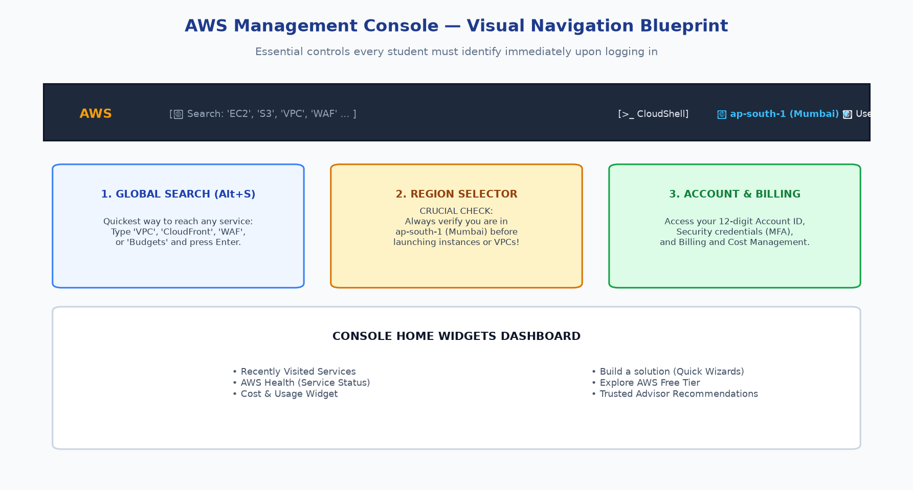

# Module 2: AWS Certified Cloud Practitioner — Complete Student Notes
> **Track:** Cloud Software Developer  
> **Course Track:** Module 2 — Cloud Foundations, Core AWS Families, Security & Management  
> **Target Audience:** Engineering Students & Cloud Beginners  

---

## 📑 Table of Contents
1. [2.a Cloud Foundations & Global Infrastructure](#1-2a-cloud-foundations--global-infrastructure)
   - [What is Cloud Computing? & The 6 Advantages](#what-is-cloud-computing--the-6-advantages)
   - [Cloud Deployment Models (Public, Private, Hybrid)](#cloud-deployment-models-public-private-hybrid)
   - [Cloud Service Models (IaaS, PaaS, SaaS)](#cloud-service-models-iaas-paas-saas)
   - [AWS Global Infrastructure: Regions, AZs, and Edge Locations](#aws-global-infrastructure-regions-azs-and-edge-locations)
2. [The 4 Core Service Families in Depth](#2-the-4-core-service-families-in-depth)
   - [Compute: Amazon EC2 & Containers (ECS)](#compute-amazon-ec2--containers-ecs)
   - [Storage: Amazon S3, EBS, and EFS](#storage-amazon-s3-ebs-and-efs)
   - [Databases & Caching: RDS, Aurora, DynamoDB & In-Memory Cache](#databases--caching-rds-aurora-dynamodb--in-memory-cache)
   - [Networking: VPC Fundamentals Overview](#networking-vpc-fundamentals-overview)
3. [2.b Management, Governance, Security & Integration](#3-2b-management-governance-security--integration)
   - [The AWS Shared Responsibility Model](#the-aws-shared-responsibility-model)
   - [AWS Identity & Access Management (IAM)](#aws-identity--access-management-iam)
   - [Monitoring & Governance: CloudWatch vs CloudTrail](#monitoring--governance-cloudwatch-vs-cloudtrail)
   - [Application Integration: SQS & SNS](#application-integration-sqs--sns)
4. [2.c AWS Free Tier, Budget Shield & Web Hosting](#4-2c-aws-free-tier-budget-shield--web-hosting)
   - [Navigating the AWS Free Tier](#navigating-the-aws-free-tier)
   - [The Budget Shield: Never Pay Unwanted Cloud Bills](#the-budget-shield-never-pay-unwanted-cloud-bills)
   - [Static Web Hosting: EC2 Linux vs Amazon S3](#static-web-hosting-ec2-linux-vs-amazon-s3)

---

## 1. 2.a Cloud Foundations & Global Infrastructure

### What is Cloud Computing? & The 6 Advantages
Cloud computing is the on-demand delivery of IT resources (compute power, database storage, applications, and networking) over the internet with **pay-as-you-go pricing**. Instead of buying, owning, and maintaining physical servers in a private data center, you rent technology services from Amazon Web Services (AWS).

#### The 6 Advantages of Cloud Computing:
1. **Trade Capital Expense (CapEx) for Variable Expense (OpEx):** Pay only for what you consume instead of investing heavily in data centers upfront.
2. **Benefit from Massive Economies of Scale:** Lower pay-as-you-go prices because AWS aggregates hundreds of thousands of customers.
3. **Stop Guessing Capacity:** Scale up during traffic spikes (e.g., Diwali or Sankranti sales) and scale down when traffic drops.
4. **Increase Speed and Agility:** Provision new servers in 30 seconds rather than waiting months for hardware procurement.
5. **Stop Spending Money Running Data Centers:** Focus on writing business code and serving users, not managing electricity and server racks.
6. **Go Global in Minutes:** Deploy applications in multiple geographic regions around the globe in a few clicks.

---

### Cloud Deployment Models

```
+-----------------------------------------------------------------------------------+
| 1. PUBLIC CLOUD       | 2. PRIVATE CLOUD          | 3. HYBRID CLOUD               |
| Entirely on AWS,      | On-premises data center   | Seamless mix of both:         |
| Azure, or Google      | owned & maintained        | On-prem legacy servers linked |
| Cloud infrastructure. | privately by a company.   | to AWS via VPN or DirectConnect|
+-----------------------------------------------------------------------------------+
```

---

### Cloud Service Models (IaaS, PaaS, SaaS)

| Model | Full Name | Real-World Analogy | You Manage | AWS Manages | AWS Examples |
|---|---|---|---|---|---|
| **IaaS** | Infrastructure as a Service | Rented empty unfurnished house | OS, Middleware, Runtime, Apps, Data | Virtualization, Servers, Hard drives, Networking | Amazon EC2, Amazon EBS, Amazon VPC |
| **PaaS** | Platform as a Service | Fully furnished hotel room | Your Application Code & Data | Operating System, Security Patches, Server hardware | AWS Elastic Beanstalk, AWS Lambda |
| **SaaS** | Software as a Service | Staying at an all-inclusive resort | Just your user settings & data | EVERYTHING (Hardware, OS, Software, Updates) | Gmail, Microsoft 365, Salesforce |

---

### AWS Global Infrastructure: Regions, AZs, and Edge Locations

```
+-----------------------------------------------------------------------------------+
| AWS GLOBAL NETWORK                                                                |
|                                                                                   |
|  [ AWS REGION: ap-south-1 (Mumbai) ]                                               |
|  +-----------------------------------------------------------------------------+  |
|  |   [ AZ: ap-south-1a ]      [ AZ: ap-south-1b ]      [ AZ: ap-south-1c ]     |  |
|  |   (Data Center 1 & 2)      (Data Center 3 & 4)      (Data Center 5 & 6)     |  |
|  |            ^                        ^                        ^              |  |
|  |            +=== Ultra-Low Latency Fiber Redundant Links =====+              |  |
|  +-----------------------------------------------------------------------------+  |
|                                                                                   |
|  [ EDGE LOCATIONS (CloudFront CDN Points of Presence in Hyderabad, Chennai, Delhi) ]|
+-----------------------------------------------------------------------------------+
```

1. **AWS Region:** A physical geographic cluster of data centers worldwide (e.g., `ap-south-1` Mumbai, `us-east-1` N. Virginia). Each Region is completely isolated from other Regions for legal compliance and fault isolation.
2. **Availability Zone (AZ):** One or more discrete data centers with redundant power, networking, and connectivity within an AWS Region. Each Region has at least 3 AZs separated by meaningful physical distance (flood plains, power grids) to survive disasters.
3. **Edge Locations:** 450+ Points of Presence (PoPs) located in major cities worldwide (including Hyderabad, Chennai, Bengaluru) used by **Amazon CloudFront** to cache content closer to end-users for millisecond latency.

---

## 2. The 4 Core Service Families in Depth

### 1. Compute: Amazon EC2 & Containers (ECS)
* **Amazon Elastic Compute Cloud (EC2):** Resizable virtual machines in the cloud.
  - **Purchasing Options:**
    * *On-Demand:* Maximum flexibility, pay per second/hour, no upfront commitment. Ideal for development and unpredictable workloads.
    * *Reserved Instances (RI) / Savings Plans:* 1 to 3 year commitment; up to 72% discount. Ideal for steady-state databases.
    * *Spot Instances:* Bid on spare AWS capacity; up to 90% discount. AWS can reclaim instances with 2 minutes notice. Ideal for batch jobs and rendering.
* **Amazon Elastic Container Service (ECS):** Highly scalable container orchestration service to run Docker containers on AWS clusters.

---

### 2. Storage: Amazon S3, EBS, and EFS
Cloud storage comes in three distinct architectural types:

```
+-----------------------------------------------------------------------------------------+
| STORAGE ARCHITECTURE TRIAD                                                              |
|                                                                                         |
| 1. OBJECT STORAGE (S3)        2. BLOCK STORAGE (EBS)        3. FILE STORAGE (EFS)       |
| Key-value blob storage        Raw hard drive volume         Shared POSIX file system    |
| Accessible via HTTP/REST      Attached to 1 EC2 instance    Mounted by 1,000+ EC2s      |
| Photos, videos, static web    OS root disk, databases       Shared code, CMS uploads    |
+-----------------------------------------------------------------------------------------+
```

#### Amazon S3 Storage Classes & Tiers:
1. **S3 Standard:** 99.999999999% (11 9's) durability. For frequently accessed data.
2. **S3 Intelligent-Tiering:** Automatically moves objects between tiers based on changing access patterns with zero operational overhead.
3. **S3 Standard-IA (Infrequent Access):** Lower storage cost, small per-GB retrieval fee. For backups and disaster recovery.
4. **S3 Glacier Flexible Archive:** Low cost, cold archive with retrieval times from minutes to hours.
5. **S3 Glacier Deep Archive:** Lowest cost storage in the cloud ($0.00099 per GB/month). Retrieval takes 12 to 48 hours.

---

### 3. Databases & Caching: RDS, Aurora, DynamoDB & In-Memory Cache

#### Relational Databases (SQL):
* **Amazon RDS (Relational Database Service):** Managed SQL service that handles provisioning, hardware maintenance, OS/database patching, automated daily backups, and Multi-AZ replication.
  - Supports 6 engines: MySQL, PostgreSQL, MariaDB, Oracle, Microsoft SQL Server, and Amazon Aurora.
* **Amazon Aurora:** AWS's cloud-native relational database engine (compatible with MySQL and PostgreSQL). 5x faster than standard MySQL, replicates 6 copies of your data across 3 AZs automatically!

#### Non-Relational Databases (NoSQL):
* **Amazon DynamoDB:** Fully managed, serverless, key-value and document NoSQL database. Guarantees single-digit millisecond latency at any scale with automatic horizontal partitioning.

#### In-Memory Caching:
* **Amazon ElastiCache:** In-memory data store supporting Redis and Memcached. Caches frequently read database queries in RAM to reduce database load and deliver sub-millisecond response times.

---

## 3. 2.b Management, Governance, Security & Integration

### The AWS Shared Responsibility Model

```
+-----------------------------------------------------------------------------------+
|                       AWS SHARED RESPONSIBILITY MODEL                             |
|                                                                                   |
|  CUSTOMER RESPONSIBILITY: SECURITY "IN" THE CLOUD                                 |
|  - Customer Data & Encryption (at-rest & in-transit)                              |
|  - Operating System patches (on EC2 instances)                                    |
|  - Firewall & Network Configuration (Security Groups & NACLs)                     |
|  - Identity & Access Management (User passwords, MFA, IAM policies)              |
| --------------------------------------------------------------------------------- |
|  AWS RESPONSIBILITY: SECURITY "OF" THE CLOUD                                      |
|  - Physical Data Center Security (Guards, biometric access, cameras)               |
|  - Hardware & Server Maintenance                                                  |
|  - Host Operating System & Virtualization Layer (Hypervisor)                      |
|  - Global Networking Infrastructure & Underwater cables                           |
+-----------------------------------------------------------------------------------+
```

---

### AWS Identity & Access Management (IAM)

IAM is a global service that manages authentication (who are you?) and authorization (what are you allowed to do?) within your AWS account.

* **Root User:** Created when the AWS account is opened. Has complete, irrevocable administrative power. **Best practice:** Lock it with MFA and never use it for daily tasks!
* **IAM Users:** Individual identities created for employees and students.
* **IAM Groups:** Collections of IAM users (e.g., `Developers`, `DatabaseAdmins`). Permissions assigned to a group apply to all members.
* **IAM Policies:** Formal JSON documents that define permissions using the **PARC** rule:
  ```json
  {
    "Version": "2012-10-17",
    "Statement": [
      {
        "Effect": "Allow",
        "Action": ["s3:GetObject", "s3:ListBucket"],
        "Resource": "arn:aws:s3:::my-company-assets/*"
      }
    ]
  }
  ```
* **IAM Roles:** Temporary credentials assumed by AWS services (e.g., giving an EC2 instance an IAM Role to read from an S3 bucket without hardcoding access keys in scripts!).

---

### Monitoring & Governance: CloudWatch vs CloudTrail

| Feature | Amazon CloudWatch | AWS CloudTrail |
|---|---|---|
| **Core Question** | *"How are my resources performing?"* | *"Who changed what resource and when?"* |
| **Primary Focus** | Performance metrics, CPU utilization, disk space, log monitoring | Auditing, governance, user compliance, API call history |
| **Action Mechanism**| Triggers alarms, autoscaling events, and SNS notifications | Records API calls (Console, CLI, SDK) into encrypted JSON logs |
| **Analogy** | The dashboard speedometer and check-engine light in a car | The dashcam and black-box flight recorder |

---

### Application Integration: SQS & SNS
In microservice architectures, components must be **loosely coupled** so that if one service fails, the entire application doesn't crash!

* **Amazon SQS (Simple Queue Service):** Asynchronous message queue that buffers messages between decoupled services.
  - *Standard Queue:* Unlimited throughput, at-least-once delivery, best-effort ordering.
  - *FIFO Queue:* Strictly First-In-First-Out ordering, exactly-once processing.
* **Amazon SNS (Simple Notification Service):** Pub/sub notification service that fans out messages to multiple subscribers simultaneously (e.g., sending an alert simultaneously to an SQS queue, an email address, and an SMS).

---

## 4. 2.c AWS Free Tier, Budget Shield & Web Hosting

### The Budget Shield: Never Pay Unwanted Cloud Bills
To prevent accidental billing while practicing on AWS, every student must set up two cost guardrails:
1. **Zero-Spend Budget Alarm:** Alerts you via email the moment your monthly AWS charges exceed $0.01.
2. **$5 Hard Cost Threshold:** Alerts you if any unstopped EC2 instance or RDS database generates charges.

### Static Web Hosting: EC2 vs S3
* **Hosting on Amazon EC2:** You launch an Ubuntu Linux instance, install a web server engine (Nginx or Apache), and copy your portfolio HTML/CSS/JS files into `/var/www/html/`. Great for learning Linux system administration!
* **Hosting on Amazon S3:** Serverless static hosting. You upload your HTML/CSS/JS files to an S3 bucket, enable *Static Website Hosting*, and AWS serves your site globally with zero servers to manage or patch!

---

## 5. How to Navigate the AWS Management Console (Visual Walkthrough)

Understanding the AWS Console layout is essential for every cloud developer. Below is the master navigation blueprint:



### The 4 Essential Top-Bar Controls:

1. **Global Search Bar (`Alt + S`):**
   * The fastest way to find any service, documentation, or resource.
   * Type `EC2`, `S3`, `VPC`, `WAF`, or `Budgets` and press `Enter` to jump directly to the service dashboard.
2. **Region Selector (Top Right):**
   * **Crucial Rule:** Always verify that you are operating in **Asia Pacific (Mumbai) `ap-south-1`** before creating instances or VPCs. If you create an EC2 instance in `us-east-1` (N. Virginia), you will not see it when looking at the Mumbai console!
   * *Note:* Global services like **IAM**, **Route 53**, and **CloudFront** automatically set the region to **Global**.
3. **AWS CloudShell (`>_` Icon):**
   * A browser-based Linux terminal pre-authenticated with your AWS credentials and with the AWS CLI, Python, Node.js, and Git already installed!
4. **Account & Security Dropdown:**
   * Shows your 12-digit AWS Account ID.
   * Direct link to **Security credentials** (assigning MFA, rotating access keys) and **Billing and Cost Management**.

---

### Step-by-Step Navigation Paths for Key Services

| Service | Quick Search Shortcut | Direct Menu Path | What to Check First |
|---|---|---|---|
| **AWS IAM** | Type `IAM` in search | Services -> Security, Identity, & Compliance -> IAM | Verify Root MFA is active; use IAM users |
| **AWS Budgets** | Type `Budgets` in search | Services -> Cloud Financial Management -> AWS Budgets | Confirm Zero-Spend and $5 alarms are green |
| **Amazon EC2** | Type `EC2` in search | Services -> Compute -> EC2 | Verify Region is `ap-south-1` before launching |
| **Amazon S3** | Type `S3` in search | Services -> Storage -> S3 | Remember: S3 bucket names are globally unique |
| **Amazon VPC** | Type `VPC` in search | Services -> Networking & Content Delivery -> VPC | Check CIDR block `10.0.0.0/16` and subnets |
| **AWS WAF** | Type `WAF` in search | Services -> Security, Identity, & Compliance -> WAF & Shield | Check Web ACL scope (Global vs Regional) |
| **Amazon CloudFront** | Type `CloudFront` in search | Services -> Networking & Content Delivery -> CloudFront | Verify Distribution status shows `Enabled` |

---
*Created for TASK Telangana Cloud Software Developer Batch · Module 2 Notes*
