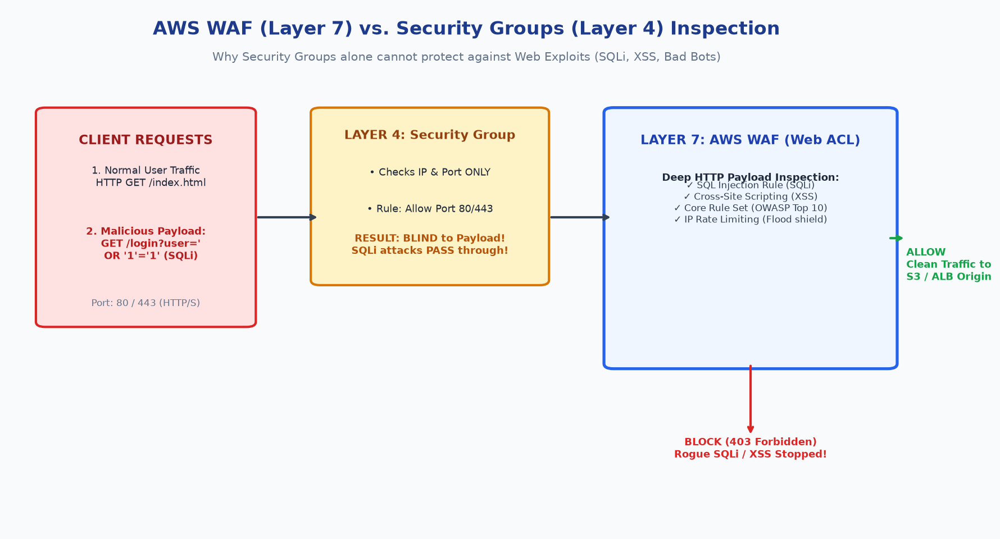
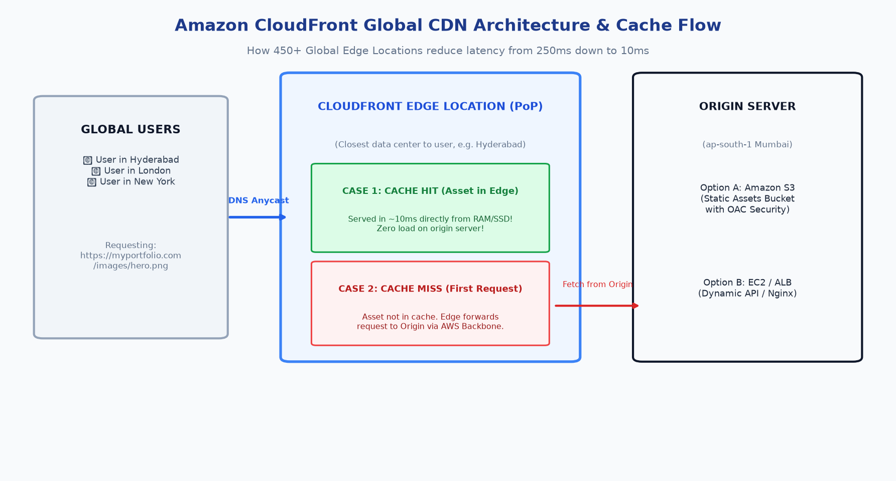
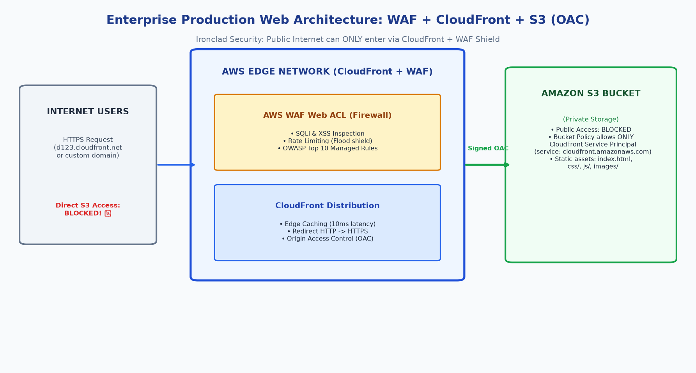

# Module 3 Part C: AWS WAF & Amazon CloudFront — Master Architecture & Navigation Guide
> **Track:** Cloud Software Developer  
> **Course Track:** Module 3 — Web Security, Content Acceleration & AWS Console Navigation  
> **Target Audience:** Engineering Students & Cloud Software Trainees  

---

## 📑 Table of Contents
1. [AWS WAF (Web Application Firewall) Deep Dive](#1-aws-waf-web-application-firewall-deep-dive)
   - [Why Do We Use AWS WAF? (The Layer 4 vs. Layer 7 Problem)](#why-do-we-use-aws-waf-the-layer-4-vs-layer-7-problem)
   - [What AWS WAF Protects Against (OWASP Top 10, SQLi, XSS, Flood Attacks)](#what-aws-waf-protects-against-owasp-top-10-sqli-xss-flood-attacks)
   - [Core WAF Building Blocks: Web ACLs, Rules & Rule Groups](#core-waf-building-blocks-web-acls-rules--rule-groups)
   - [How Web ACLs Evaluate Traffic (Priority & Default Actions)](#how-web-acls-evaluate-traffic-priority--default-actions)
2. [Step-by-Step Console Navigation: Setting Up AWS WAF](#2-step-by-step-console-navigation-setting-up-aws-waf)
3. [Amazon CloudFront (CDN) Deep Dive](#3-amazon-cloudfront-cdn-deep-dive)
   - [What is a CDN & Why Do We Use Amazon CloudFront?](#what-is-a-cdn--why-do-we-use-amazon-cloudfront)
   - [Global Edge Locations (PoPs) vs Regional Edge Caches](#global-edge-locations-pops-vs-regional-edge-caches)
   - [Origins, Behaviors & Cache Keys](#origins-behaviors--cache-keys)
   - [Origin Access Control (OAC): Locking Down S3 Securely](#origin-access-control-oac-locking-down-s3-securely)
   - [Cache Invalidation & TTL (Time-To-Live) Management](#cache-invalidation--ttl-time-to-live-management)
4. [Step-by-Step Console Navigation: Setting Up CloudFront](#4-step-by-step-console-navigation-setting-up-cloudfront)
5. [End-to-End Architecture: WAF + CloudFront + S3 (OAC)](#5-end-to-end-architecture-waf--cloudfront--s3-oac)

---

## 1. AWS WAF (Web Application Firewall) Deep Dive

### Why Do We Use AWS WAF? (The Layer 4 vs. Layer 7 Problem)

In Day 3 and Day 5, we mastered **Security Groups** and **Network ACLs**. However, both operate at **Layer 4 (Transport Layer)** of the OSI model:
* A Security Group only inspects **Source IP Address** and **Port Number** (e.g., Allow TCP Port 80 / 443).
* Once port 80 is open to the world (`0.0.0.0/0`), **any data packet can enter**!

#### The Real-World Attack Scenario:
Suppose an attacker submits this login form in their web browser:
```sql
Username: admin' OR '1'='1'; --
Password: password
```
* **Security Group Reaction:** The packet arrives on Port 443 (HTTPS). The Security Group sees valid port 443 traffic and **lets it pass right through**! The database executes the SQL injection and dumps all student passwords!
* **AWS WAF Reaction:** AWS WAF inspects the actual **HTTP/S payload (Layer 7 - Application Layer)**. It reads the string `OR '1'='1'`, recognizes the signature of a SQL injection attack, and **instantly drops the connection with `403 Forbidden`** before the request ever reaches your server or database!



---

### What AWS WAF Protects Against

AWS WAF inspects HTTP/HTTPS headers, query strings, cookies, request bodies, and URI paths to defend against:
1. **SQL Injection (SQLi):** Malicious SQL queries injected into input boxes to steal or delete database tables.
2. **Cross-Site Scripting (XSS):** Attackers injecting malicious JavaScript scripts that execute inside other users' browsers.
3. **HTTP Flood / Layer 7 DDoS:** Automated botnets overwhelming your web servers with 100,000 requests per second.
4. **Bad Bots & Scrapers:** Web scrapers stealing your intellectual property or guessing login passwords (credential stuffing).
5. **OWASP Top 10 Web Application Security Risks.**

---

### Core WAF Building Blocks: Web ACLs, Rules & Rule Groups

* **Web ACL (Access Control List):** The top-level container for your firewall configuration. You associate a Web ACL with an **Amazon CloudFront Distribution**, an **Application Load Balancer (ALB)**, or an **Amazon API Gateway**.
* **Rule:** An individual condition that inspects a request and takes an action (**ALLOW**, **BLOCK**, **COUNT**, or **CAPTCHA**).
* **AWS Managed Rule Groups:** Pre-packaged collections of rules maintained and updated daily by AWS threat intelligence teams:
  - `AWSManagedRulesCommonRuleSet` (Core Rule Set - CRS): Baseline protection against OWASP Top 10 exploits.
  - `AWSManagedRulesSQLiRuleSet`: Specialized protection against database SQL injection patterns.
  - `AWSManagedRulesKnownBadInputsRuleSet`: Blocks known invalid request patterns and command injection.
  - `AWSManagedRulesAmazonIpReputationList`: Blocks requests from known botnets, Tor exit nodes, and malicious IPs.

---

### How Web ACLs Evaluate Traffic (Priority & Default Actions)

```
Incoming HTTP/S Request
           |
           v
+-----------------------------------------------------------+
| WEB ACL EVALUATION PIPELINE                               |
|                                                           |
| 1. Rule 1 (Priority 0): AWS Managed Core Rule Set (CRS)   |
|    --> Matches OWASP exploit? =====> [ BLOCK: 403 ]       |
|                                                           |
| 2. Rule 2 (Priority 1): AWS Managed SQLi Rule Set         |
|    --> Matches SQL injection? =====> [ BLOCK: 403 ]       |
|                                                           |
| 3. Rule 3 (Priority 2): Rate-based IP Rule                |
|    --> > 500 requests / 5 min? ====> [ BLOCK / CAPTCHA ]  |
|                                                           |
| 4. DEFAULT ACTION (If no rule blocked the traffic):       |
|    ================================> [ ALLOW (Forward) ]  |
+-----------------------------------------------------------+
```

---

## 2. Step-by-Step Console Navigation: Setting Up AWS WAF

Follow these exact steps to navigate the AWS Console and deploy AWS WAF:

### Phase 1: Open the WAF Console
1. Log in to the [AWS Management Console](https://console.aws.amazon.com/).
2. In the top search bar, type `WAF` and click **AWS WAF & Shield**.

### Phase 2: Create a Web ACL
1. In the left navigation pane, click **Web ACLs**.
2. Make sure your region filter is set to:
   * **Global (CloudFront)** if protecting a CloudFront distribution.
   * **Asia Pacific (Mumbai) `ap-south-1`** if protecting an Application Load Balancer.
3. Click the orange **Create web ACL** button.

### Phase 3: Describe Web ACL and Associate Resources
1. **Name:** `task-student-production-waf`.
2. **Resource type:** Select **Amazon CloudFront distributions** (or Regional resources).
3. Under *Associated AWS resources*, click **Add AWS resources** -> Choose your CloudFront distribution -> Click **Add**.
4. Click **Next**.

### Phase 4: Add AWS Managed Rules
1. Click the **Add rules** dropdown -> Select **Add managed rule groups**.
2. Scroll down to **AWS managed rule groups** and click **Paid rule groups** / **Free rule groups**:
   * Enable **Core rule set** -> Toggle **Add to web ACL**.
   * Enable **SQL database** -> Toggle **Add to web ACL**.
   * Enable **Known bad inputs** -> Toggle **Add to web ACL**.
3. Click **Add rules** at the bottom.

### Phase 5: Set Default Web ACL Action
1. Under *Default action*, select **Allow** *(Clean traffic will pass through; only malicious exploit requests matching our rules will be blocked!)*.
2. Click **Next** -> Leave Rule Priorities at default -> Click **Next**.
3. Leave CloudWatch metrics enabled -> Click **Next** -> Click **Create web ACL**.
4. *Result:* Your web endpoints are now guarded by enterprise-grade Layer 7 protection!

---

## 3. Amazon CloudFront (CDN) Deep Dive

### What is a CDN & Why Do We Use Amazon CloudFront?

A **Content Delivery Network (CDN)** is a globally distributed network of proxy servers that cache web content (HTML files, images, CSS, JavaScript, videos) geographically close to users to deliver lightning-fast loading speeds.

#### The 3 Core Benefits of CloudFront:
1. **Dramatically Reduces Latency:** If your web server is located in Mumbai (`ap-south-1`) and a user opens your portfolio from London or New York, the packet takes 250 milliseconds to cross underwater cables. With CloudFront, the image is served from a London Edge Location in **10 milliseconds**!
2. **Offloads 95%+ of Traffic from Origin:** Your S3 bucket or EC2 server doesn't get overloaded during traffic spikes because cached requests are absorbed at the edge.
3. **Free Built-in DDoS Protection & SSL:** CloudFront integrates natively with **AWS Shield Standard** to protect against Layer 3/4 network DDoS attacks, and provides free TLS/HTTPS encryption.



---

### Global Edge Locations (PoPs) vs Regional Edge Caches

* **Edge Locations (450+ Points of Presence):** Data centers in major cities worldwide (including Hyderabad, Bengaluru, Chennai, Mumbai, Delhi, London, Tokyo, Singapore). They serve cached content directly to the user's browser.
* **Regional Edge Caches (REC):** Larger regional storage tiers positioned between Edge Locations and your Origin. When a local edge location has a cache miss, it checks the Regional Edge Cache before bothering your origin server!

---

### Origins, Behaviors & Cache Keys

* **Origin:** The definitive source of your web assets. Can be an **Amazon S3 bucket**, an **Application Load Balancer (ALB)**, an **Amazon EC2 instance**, or any external HTTP web server.
* **Behavior:** A set of routing and caching rules based on URL path patterns:
  - Example 1: `Path: /images/*` -> Cache at edge for 30 days (`CacheOptimized`).
  - Example 2: `Path: /api/*` -> Forward all query strings and headers directly to the backend ALB with **zero caching** (`CachingDisabled`)!
* **Viewer Protocol Policy:** Always configure **Redirect HTTP to HTTPS** so all student web traffic is automatically encrypted over TLS!

---

### Origin Access Control (OAC): Locking Down S3 Securely

> ⚠️ **Critical Security Warning for Cloud Engineers:**  
> When you host a website on Amazon S3 with CloudFront, you must **NEVER make the S3 bucket publicly readable** to the world! If the bucket is public, users can bypass CloudFront and WAF security simply by accessing the S3 bucket URL directly!

#### The Solution: Origin Access Control (OAC)
1. Keep the S3 bucket **100% private** (Block All Public Access: ON).
2. Configure CloudFront with **Origin Access Control (OAC)**.
3. Add a Bucket Policy on S3 that allows access **ONLY to the CloudFront Service Principal** (`cloudfront.amazonaws.com` matching your distribution ARN).
4. *Result:* Nobody on Earth can access the bucket except through your secure CloudFront CDN!



---

### Cache Invalidation & TTL (Time-To-Live) Management

* **Time-To-Live (TTL):** Determines how long CloudFront keeps a cached file before checking the origin for updates (Default TTL is 24 hours).
* **Cache Invalidation:** If you fix a typo in your portfolio's `index.html` and upload it to S3, CloudFront edge locations will continue serving the old cached version until TTL expires!
* **How to Fix:** Submit a **Cache Invalidation** in CloudFront:
  - Path `/*`: Flushes all cached files across all 450+ edge servers worldwide in under 60 seconds.
  - Path `/index.html`: Flushes only the homepage.

---

## 4. Step-by-Step Console Navigation: Setting Up CloudFront

Follow these exact steps to create and configure CloudFront:

### Phase 1: Open the CloudFront Console
1. Search for `CloudFront` in the AWS console search bar and open the service.
2. Click the orange **Create distribution** button.

### Phase 2: Configure Origin Settings
1. **Origin domain:** Click the text box and select your S3 bucket (e.g., `my-portfolio-bucket.s3.ap-south-1.amazonaws.com`).
2. **Origin access:**
   * Select **Origin access control settings (recommended)**.
   * Click **Create control setting** -> Name: `task-s3-oac` -> Click **Create**.
   * *Notice:* AWS will display a yellow banner reminding you to copy the bucket policy after creation!

### Phase 3: Configure Default Cache Behavior
1. **Viewer protocol policy:** Select **Redirect HTTP to HTTPS**.
2. **Allowed HTTP methods:** `GET, HEAD` (or `GET, HEAD, OPTIONS, PUT, POST, PATCH, DELETE` for dynamic APIs).
3. **Cache key and origin requests:** Select **CacheOptimized**.

### Phase 4: Configure Web Application Firewall (WAF)
1. Under *Web Application Firewall (WAF)*:
   * Select **Use existing WAF configuration** -> Choose your `task-student-production-waf` Web ACL created in Section 2!

### Phase 5: Deploy & Update S3 Bucket Policy
1. Click **Create distribution**.
2. AWS displays a banner: *"The S3 bucket policy needs to be updated."* Click **Copy policy**.
3. Open your S3 bucket in a new tab -> Click **Permissions** -> **Bucket policy** -> Click **Edit** -> Paste the copied policy -> Click **Save changes**.
4. Return to CloudFront -> Wait for the distribution status to show **Enabled**.
5. Copy your **Distribution domain name** (e.g., `https://d12345abcdef.cloudfront.net`) and test it in your browser!

---

## 5. End-to-End Architecture: WAF + CloudFront + S3 (OAC)

| Step | User Action / Flow | What Component Handles It | Security / Performance Benefit |
|---|---|---|---|
| **1** | User enters `https://myportfolio.com` in browser | Route 53 / Anycast DNS | Directs user to the closest of 450+ Edge Locations |
| **2** | Packet arrives at Edge Location | **AWS WAF** | Inspects HTTP payload; blocks SQLi, XSS, and bots |
| **3** | Clean request reaches CDN cache | **CloudFront** (Cache Hit) | If asset is cached, served in **10ms**; stops here |
| **4** | First request for new asset (Cache Miss) | **CloudFront OAC** | Generates signed SigV4 request to origin |
| **5** | Secure fetch from origin | **Amazon S3** | S3 verifies CloudFront signature & serves file |
| **6** | Edge caches file & responds to user | **CloudFront Edge** | Subsequent requests from anyone nearby are instant |

---
*Created for TASK Telangana Cloud Software Developer Batch · Module 3 Master Guide*
