# Module 4: Cloud Architecture, Enterprise Networking & Elastic Load Balancing
> **Program:** Telangana Academy for Skill and Knowledge (TASK)  
> **Course Track:** Cloud Software Developer (Module 4: AWS Solutions Architect / SAA-C03 / DVA-C02)  
> **Trainer:** Sundeep Hiremat  
> **Document Type:** Master Architecture & Comprehensive Engineering Study Guide (Topics 4.1a – 4.4a)  
> **Target Audience:** Engineering Students, Cloud Developers & AWS Solutions Architect Candidates  

---

## 📑 Table of Contents
1. [4.1a AWS Well-Architected Framework & Architectural Design Principles](#1-41a-aws-well-architected-framework--architectural-design-principles)
   - [The Six General Design Principles](#the-six-general-design-principles)
   - [The Six Core Pillars of Well-Architected Design](#the-six-core-pillars-of-well-architected-design)
   - [Architectural Discovery: The Client & Stakeholder Interview Checklist](#architectural-discovery-the-client--stakeholder-interview-checklist)
2. [4.2a VPC Networking, Cross-VPC Peering, Endpoints & Transit Gateway](#2-42a-vpc-networking-cross-vpc-peering-endpoints--transit-gateway)
   - [How the Web and Web Servers Operate: Low-Level Packet Mechanics](#how-the-web-and-web-servers-operate-low-level-packet-mechanics)
   - [The Sandhya 70mm Multiplex Telugu Analogy (VPC Architecture)](#the-sandhya-70mm-multiplex-telugu-analogy-vpc-architecture)
   - [VPC Peering: Architecture, Routing & Non-Transitive Boundaries](#vpc-peering-architecture-routing--non-transitive-boundaries)
   - [VPC Endpoints: Gateway Endpoints vs. Interface Endpoints (AWS PrivateLink)](#vpc-endpoints-gateway-endpoints-vs-interface-endpoints-aws-privatelink)
   - [AWS Transit Gateway (TGW): Star Hub-and-Spoke vs. Full Mesh Nightmare](#aws-transit-gateway-tgw-star-hub-and-spoke-vs-full-mesh-nightmare)
   - [VPC Reachability Analyzer & Common Networking Mistakes Matrix](#vpc-reachability-analyzer--common-networking-mistakes-matrix)
3. [Route 53 DNS, The Global Internet & Cryptographic HTTPS Transport](#3-route-53-dns-the-global-internet--cryptographic-https-transport)
   - [How DNS Resolution Works: Recursive to Authoritative](#how-dns-resolution-works-recursive-to-authoritative)
   - [Route 53 Record Types & The Zone Apex ALIAS Advantage](#route-53-record-types--the-zone-apex-alias-advantage)
   - [The Six Route 53 Routing Policies In-Depth](#the-six-route-53-routing-policies-in-depth)
   - [Public vs. Private Hosted Zones (Split-View DNS)](#public-vs-private-hosted-zones-split-view-dns)
   - [How HTTPS & TLS 1.3 Work: Asymmetric Handshake & Symmetric Session Data](#how-https--tls-13-work-asymmetric-handshake--symmetric-session-data)
4. [4.3a Elastic Load Balancing (ELB) Deep Dive](#4-43a-elastic-load-balancing-elb-deep-dive)
   - [OSI 7-Layer Reference Model vs. AWS Load Balancers](#osi-7-layer-reference-model-vs-aws-load-balancers)
   - [How to Choose a Load Balancer: Architectural Decision Matrix](#how-to-choose-a-load-balancer-architectural-decision-matrix)
   - [Application Load Balancer (ALB): Layer 7 Intelligent Content Routing](#application-load-balancer-alb-layer-7-intelligent-content-routing)
   - [Network Load Balancer (NLB): Layer 4 Extreme Performance & Static IPs](#network-load-balancer-nlb-layer-4-extreme-performance--static-ips)
   - [Gateway Load Balancer (GWLB): Transparent Inline Security Appliance Fleet](#gateway-load-balancer-gwlb-transparent-inline-security-appliance-fleet)
   - [Connection Draining / Deregistration Delay Deep Dive](#connection-draining--deregistration-delay-deep-dive)
   - [ELB Troubleshooting Master Guide: HTTP 502, 503, 504 & 400 Root Causes](#elb-troubleshooting-master-guide-http-502-503-504--400-root-causes)
5. [4.4a Auto Scaling, ElastiCache & Cost Optimization](#5-44a-auto-scaling-elasticache--cost-optimization)
   - [Horizontal Scaling (Scale Out/In) vs. Vertical Scaling (Scale Up/Down)](#horizontal-scaling-scale-outin-vs-vertical-scaling-scale-updown)
   - [EC2 Auto Scaling Groups (ASG) Mechanics & Scaling Policies](#ec2-auto-scaling-groups-asg-mechanics--scaling-policies)
   - [ElastiCache Deep Dive: Redis/Valkey vs. Memcached & Caching Patterns](#elasticache-deep-dive-redisvalkey-vs-memcached--caching-patterns)
   - [Architectural Cost Engineering & Optimization Strategies](#architectural-cost-engineering--optimization-strategies)
6. [AWS Solutions Architect Certification & Real-World Interview Scenarios](#6-aws-solutions-architect-certification--real-world-interview-scenarios)
7. [Module 4 Hands-On Labs Architecture & Preparation Roadmap](#7-module-4-hands-on-labs-architecture--preparation-roadmap)

---

## 1. 4.1a AWS Well-Architected Framework & Architectural Design Principles

In enterprise cloud computing, an architecture is not merely a collection of virtual servers running code; it is a continuously evolving, highly resilient engineering ecosystem designed to satisfy business objectives without incurring unnecessary financial waste, operational fragility, or security liabilities.

AWS introduced the **Well-Architected Framework** to provide a systematic, repeatable methodology for evaluating architectures against industry best practices.

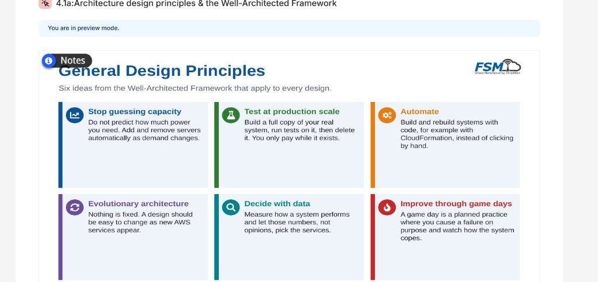

### The Six General Design Principles

The Well-Architected Framework begins with six overarching design principles that must guide every architectural decision:

1. **Stop guessing capacity:**
   * *Problem:* In traditional on-premises data centers, IT managers were forced to forecast user demand 3 to 5 years into the future. If they under-provisioned servers, the application crashed during traffic surges (e.g., Diwali or Black Friday flash sales). If they over-provisioned, millions of dollars sat idle as unused hardware consuming electricity and cooling.
   * *Cloud Solution:* Leverage dynamic elasticity. Deploy Auto Scaling Groups (ASG) and serverless architectures (AWS Lambda, Fargate) that automatically scale up compute instances when traffic increases and terminate them when traffic subsides. You pay strictly for what you consume per second.

2. **Test at production scale:**
   * *Problem:* On-premises teams rarely had the budget to purchase a duplicate secondary data center solely for performance load testing. Staging environments were typically 10% the size of production, leading to unexpected race conditions, database deadlocks, and memory leaks when code was promoted to production.
   * *Cloud Solution:* In AWS, you can use Infrastructure as Code (AWS CloudFormation or Terraform) to spin up an exact, 100% duplicate clone of your production infrastructure in a separate VPC, run extreme load tests simulating 500,000 concurrent users for two hours, collect diagnostic telemetry, and immediately tear down the environment. You only pay for the 2 hours of compute time.

3. **Automate to make architectural experimentation easier:**
   * *Problem:* Manual server configuration via the AWS Management Console is error-prone, undocumented, and impossible to audit or reproduce reliably.
   * *Cloud Solution:* Replace manual clicking with automated code. Define VPCs, subnets, route tables, load balancers, and security groups as declarative code. This allows teams to create, track, version-control, and roll back entire cloud environments with zero human intervention.

4. **Allow for evolutionary architecture:**
   * *Problem:* Static hardware architectures lock organizations into decisions for half a decade. By the time hardware depreciates, modern paradigms (containers, serverless, microservices) have made the legacy stack obsolete.
   * *Cloud Solution:* Design modular systems with loose coupling (using queues like SQS, pub/sub via SNS, and event brokers via EventBridge). Small microservice components can be upgraded or replaced with newer AWS services (e.g., migrating from self-managed PostgreSQL on EC2 to Amazon Aurora Serverless v2) without breaking dependent applications.

5. **Drive architectures using data:**
   * *Problem:* Traditional system design was governed by subjective opinions, developer bias, and guesswork regarding bottleneck locations.
   * *Cloud Solution:* Collect actionable telemetry using Amazon CloudWatch, AWS X-Ray distributed tracing, and VPC Flow Logs. Make architectural modifications based on real empirical metrics (e.g., p99 latency distributions, CPU-to-memory ratios, database IOPS saturation) rather than theoretical assumptions.

6. **Improve through game days:**
   * *Problem:* Disaster recovery documentation often sits in static binder PDFs, completely untested until a catastrophic real-world outage strikes at 3:00 AM on Sunday.
   * *Cloud Solution:* Schedule regular "Game Days" where cross-functional engineering teams deliberately inject controlled failures into production or staging systems (e.g., using AWS Fault Injection Simulator to terminate database primary nodes, sever AZ connectivity, or simulate network latency). Teams observe how automated self-healing mechanisms respond and train their incident responders under realistic conditions.

---

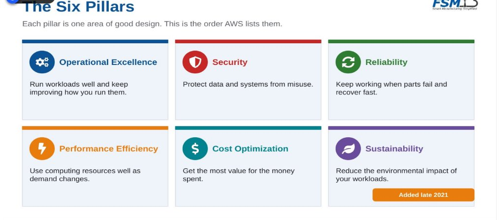

### The Six Core Pillars of Well-Architected Design

The AWS Well-Architected Framework categorizes best practices into six distinct pillars. Every enterprise system must be audited against these pillars:

| Pillar | Core Mission | Key Architectural Focus Areas & AWS Services |
| :--- | :--- | :--- |
| **1. Operational Excellence** | Run workloads effectively, gain deep insight into their operations, and continuously improve processes. | • **IaC:** AWS CloudFormation, AWS CDK, Terraform.<br>• **Observability:** Amazon CloudWatch metrics, alarms, logs, AWS X-Ray.<br>• **Operational Health:** AWS Systems Manager (SSM), EventBridge automation.<br>• **Small, Reversible Changes:** Blue/Green deployments, Canary releases via CodeDeploy. |
| **2. Security** | Protect data, systems, identities, and assets while delivering business value through risk assessments and mitigation. | • **Identity & Access Management:** IAM least privilege, MFA, IAM Roles (no hardcoded keys).<br>• **Data Protection:** AWS KMS (Envelope Encryption), AWS Secrets Manager.<br>• **Infrastructure Protection:** VPC Private Subnets, Security Groups, NACLs, AWS WAF, AWS Shield.<br>• **Detection & Auditing:** AWS CloudTrail (immutable audit log), Amazon GuardDuty, AWS Config. |
| **3. Reliability** | Ensure a workload performs its intended function correctly and consistently, recovering rapidly from infrastructure failures. | • **High Availability:** Multi-AZ deployments for EC2, RDS, and ElastiCache.<br>• **Fault Tolerance:** Elastic Load Balancers (ALB/NLB), Auto Scaling Groups.<br>• **Loose Coupling:** Amazon SQS (decoupling producers and consumers), Amazon SNS.<br>• **Disaster Recovery:** Automated cross-region backups, Amazon Route 53 DNS Failover. |
| **4. Performance Efficiency** | Use computing resources efficiently to meet system requirements and maintain efficiency as demand evolves and technologies change. | • **Compute Optimization:** Selecting optimal EC2 instance types (Compute, Memory, or Storage optimized; Graviton processors).<br>• **Caching Layers:** Amazon CloudFront (CDN edge caching), Amazon ElastiCache (Redis/Memcached in-memory data caching).<br>• **Storage Tiering:** Amazon S3 Intelligent-Tiering, Provisioned IOPS (io2) EBS volumes.<br>• **Networking:** AWS Global Accelerator, Enhanced Networking (ENA). |
| **5. Cost Optimization** | Deliver business value at the lowest price point by eliminating waste, selecting optimal pricing models, and monitoring expenditure. | • **Expenditure Awareness:** AWS Cost Explorer, AWS Budgets (real-time alerts).<br>• **Right-Sizing:** AWS Compute Optimizer (analyzing CPU/RAM over-provisioning).<br>• **Pricing Models:** Spot Instances (up to 90% discount for fault-tolerant batch work), Compute Savings Plans / Reserved Instances.<br>• **Data Transfer Economics:** S3 Gateway Endpoints (free S3 traffic), S3 Bucket Keys (99% KMS cost reduction). |
| **6. Sustainability** *(Added Late 2021)* | Minimize the environmental and carbon footprint of running cloud workloads through resource optimization. | • **Region Selection:** Deploying in regions powered by renewable energy grids (e.g., Oregon, Ireland, Frankfurt).<br>• **Hardware Efficiency:** Migrating workloads from x86 Intel/AMD to AWS Graviton3/Graviton4 ARM processors (delivers up to 60% less energy consumption for identical compute).<br>• **Lifecycle Management:** S3 Lifecycle rules to delete stale logs and archive cold data to Glacier Flexible Deep Archive. |

---

### Architectural Discovery: The Client & Stakeholder Interview Checklist

Before drawing a single architecture diagram or spinning up a VPC, a senior AWS Solutions Architect must conduct a rigorous architectural discovery interview with business stakeholders, product managers, and engineering leads.

An architect who asks the wrong questions designs an expensive, fragile, or non-compliant system. Below is the mandatory interview framework:

```
┌─────────────────────────────────────────────────────────────────────────────────┐
│              SOLUTIONS ARCHITECT DISCOVERY INTERVIEW FRAMEWORK                  │
├─────────────────────────────────────────────────────────────────────────────────┤
│ 1. Business Continuity: RTO & RPO Definitions                                  │
│    • What is the Maximum Tolerable Downtime (RTO)?                              │
│    • How much data loss can the business tolerate in a disaster (RPO)?          │
├─────────────────────────────────────────────────────────────────────────────────┤
│ 2. Uptime & SLA Commitments                                                     │
│    • Is the target 99.9% (~8.7h downtime/yr) or 99.999% (~5m downtime/yr)?     │
│    • What financial penalties exist if SLAs are breached?                      │
├─────────────────────────────────────────────────────────────────────────────────┤
│ 3. Traffic Profile & Seasonality                                                │
│    • What is the average vs. peak Requests Per Second (RPS)?                   │
│    • Are traffic spikes predictable (flash sales) or sudden (breaking news)?    │
├─────────────────────────────────────────────────────────────────────────────────┤
│ 4. Data Residency, Sovereignty & Regulatory Compliance                          │
│    • Must user data stay inside India (RBI regulations, DPDP Act 2023)?         │
│    • Does the workload handle healthcare (HIPAA) or credit cards (PCI-DSS)?     │
├─────────────────────────────────────────────────────────────────────────────────┤
│ 5. Latency Tolerances                                                           │
│    • What is the p99 end-to-end response time budget (e.g., < 100ms globally)? │
│    • Can background tasks be processed asynchronously via queues (SQS)?         │
├─────────────────────────────────────────────────────────────────────────────────┤
│ 6. Financial Appetite & Cost Models (CapEx vs. OpEx)                           │
│    • What is the monthly infrastructure spending ceiling?                       │
│    • Can the business commit to 1-year or 3-year Savings Plans for discounts?   │
└─────────────────────────────────────────────────────────────────────────────────┘
```

#### Detailed Questions & Architectural Implications

1. **RTO (Recovery Time Objective) and RPO (Recovery Point Objective):**
   * *Question:* "If our primary AWS region experiences an unprecedented fiber-cut outage, how many minutes or hours can your business survive before services must be restored (RTO)? And how many minutes of transactional data are you willing to permanently lose (RPO)?"
   * *Implication:* If RTO/RPO is hours, a simple **Backup & Restore** strategy using cross-region S3 backups and RDS snapshots is sufficient ($). If RTO/RPO must be zero seconds, you must architect a **Multi-Region Active-Active** deployment with Amazon Aurora Global Database and Route 53 Geoproximity routing ($$$$$).

2. **SLA (Service Level Agreement) Targets:**
   * *Question:* "What is your target availability percentage?"
   * *The Math of Availability:*
     * 99% Uptime ("Two Nines") = 3.65 days downtime per year.
     * 99.9% Uptime ("Three Nines") = 8.76 hours downtime per year.
     * 99.99% Uptime ("Four Nines") = 52.56 minutes downtime per year.
     * 99.999% Uptime ("Five Nines") = 5.26 minutes downtime per year.
   * *Implication:* Each additional "nine" doubles or triples infrastructure complexity and cost. Achieving 99.99% requires multi-AZ redundancy across load balancers, web servers, and databases with automated failover. Achieving 99.999% requires zero-downtime blue/green deployments, chaos-tested self-healing, and multi-region failover.

3. **Traffic Profile & Concurrency:**
   * *Question:* "What are your baseline and peak Requests Per Second (RPS)? What is the payload size per request? Do surges happen instantaneously (e.g., a push notification sent to 10 million users) or gradually over hours?"
   * *Implication:* Instantaneous surges overwhelm EC2 Auto Scaling Groups because spinning up a new virtual machine takes 2 to 5 minutes. Instant surges require serverless compute (AWS Lambda), pre-warmed Application Load Balancers, or an aggressive step-scaling policy based on SQS queue depth.

4. **Regulatory Compliance and Data Sovereignty:**
   * *Question:* "Where are your end-users located? Are there legal restrictions regarding where their data is stored and processed?"
   * *Implication:* Indian financial institutions (governed by the Reserve Bank of India) and health platforms require all financial/personal data to reside within Indian borders. Deploying to `ap-south-1` (Mumbai) or `ap-south-2` (Hyderabad) is legally mandatory; replicating data to `us-east-1` (N. Virginia) is an immediate regulatory violation.

5. **Latency Budgets:**
   * *Question:* "What is the acceptable latency budget for API responses?"
   * *Implication:* If user latency must be under 20ms worldwide, static assets must be served via Amazon CloudFront edge locations, API calls must be accelerated via AWS Global Accelerator, and database read operations must be cached in Amazon ElastiCache (Redis).

---

## 2. 4.2a VPC Networking, Cross-VPC Peering, Endpoints & Transit Gateway

Networking is the foundational backbone of all cloud computing. Every EC2 instance, database cluster, container task, and internal load balancer resides inside an **Amazon Virtual Private Cloud (VPC)**.

### How the Web and Web Servers Operate: Low-Level Packet Mechanics

To understand VPC routing, an engineer must first understand what occurs under the hood when a human user opens a web browser and navigates to `https://app.example.com`:

```
┌────────────────────────────────────────────────────────────────────────────────────────────────┐
│                         END-TO-END WEB REQUEST PACKET LIFECYCLE                                │
└────────────────────────────────────────────────────────────────────────────────────────────────┘

 1. CLIENT BROWSER                  2. ROUTE 53 DNS RESOLUTION         3. TCP 3-WAY HANDSHAKE
 ┌─────────────────┐                ┌───────────────────────┐          ┌─────────────────────┐
 │ User enters     │                │ Recursive Resolver    │          │ Client sends:       │
 │ app.example.com │ ─────────────> │ resolves domain to    │ ───────> │ [SYN]               │
 │ in Chrome       │                │ Public IP: 13.232.x.x │          │ Server replies:     │
 └─────────────────┘                └───────────────────────┘          │ [SYN-ACK]           │
                                                                       │ Client acknowledges:│
                                                                       │ [ACK]               │
                                                                       └─────────────────────┘
                                                                                  │
                                                                                  ▼
 6. HTTP RESPONSE BODY              5. WEB SERVER / WSGI PROCESS       4. TLS 1.3 SECURE SESSION
 ┌─────────────────┐                ┌───────────────────────┐          ┌─────────────────────┐
 │ HTML/JSON packet│                │ Nginx / Gunicorn /    │          │ Asymmetric Key      │
 │ rendered in     │ <───────────── │ Python Flask receives │ <─────── │ Exchange (ECDHE);   │
 │ user browser    │                │ HTTP GET request from │          │ Symmetric AES-256   │
 └─────────────────┘                │ OS socket buffer      │          │ wire encryption     │
                                    └───────────────────────┘          └─────────────────────┘
```

1. **DNS Resolution:** The client browser queries its local operating system cache, then queries the local ISP recursive resolver, which queries the Root (`.`), TLD (`.com`), and Authoritative Nameserver (Amazon Route 53) to translate `app.example.com` into an IP address (e.g., `13.232.14.88`).
2. **TCP 3-Way Handshake (Layer 4):** The client's operating system generates a TCP SYN packet destined for port 443 of the server's public IP. The server receives the SYN, allocates a transmission control block (TCB), and returns a SYN-ACK packet. The client responds with an ACK packet. The reliable Layer 4 TCP connection is established.
3. **TLS Cryptographic Handshake (Layer 6):** The client and server negotiate cipher suites (e.g., TLS 1.3 with ECDHE key exchange and AES-256-GCM symmetric encryption). The server presents its X.509 SSL/TLS digital certificate issued by AWS Certificate Manager (ACM). Once validated, an encrypted tunnel is active.
4. **HTTP Request Generation (Layer 7):** The client sends an HTTP GET request containing headers (`Host: app.example.com`, `User-Agent: Mozilla/5.0`, `Accept: application/json`, `Cookie: session_id=...`).
5. **Operating System Socket Buffer to Application:** The host network interface card (NIC) receives the electrical/optical bitstream, converts it into Ethernet frames, decapsulates the IP packet, verifies the TCP checksum, and places the raw bytes into the kernel's TCP socket receive buffer.
6. **Web Server / Reverse Proxy Processing:** The web server software (e.g., Nginx, Apache HTTPD, or AWS Application Load Balancer) reads from the socket. If Nginx is functioning as a reverse proxy, it matches the HTTP `Host` and `URI` path against its configuration blocks and forwards the request via an upstream Unix socket or internal TCP connection to an application server (e.g., Gunicorn running Python Django/Flask, or Node.js).
7. **Database Query & Response Execution:** The application server executes business logic, queries an Amazon RDS PostgreSQL database over private VPC IP addresses, serializes the resulting records into JSON, wraps it in an HTTP 200 OK response with `Content-Type: application/json`, and flushes the bytes back down the TCP connection to the user.

---

### The Sandhya 70mm Multiplex Telugu Analogy (VPC Architecture)

To make abstract cloud networking concrete, intuitive, and unforgettable, we map every component of an Amazon VPC to the famous **Sandhya 70mm Multiplex at RTC X Roads, Hyderabad**.

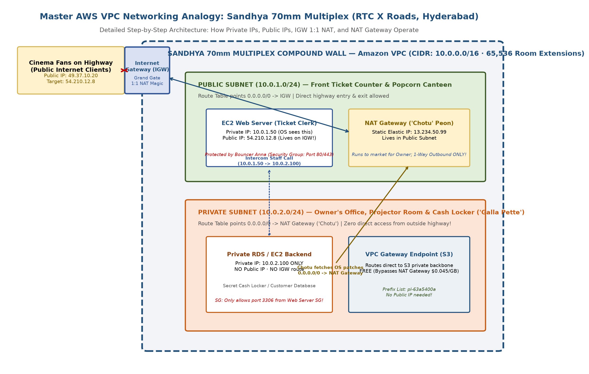

```
┌─────────────────────────────────────────────────────────────────────────────────────────────┐
│              THE SANDHYA 70mm MULTIPLEX (RTC X ROADS) VPC ANALOGY                           │
├──────────────────────────┬─────────────────────────────┬────────────────────────────────────┤
│ AWS VPC Component        │ Sandhya 70mm Analogy        │ Real-World Networking Function     │
├──────────────────────────┼─────────────────────────────┼────────────────────────────────────┤
│ Amazon VPC               │ The Entire Multiplex        │ A logically isolated virtual       │
│                          │ Compound at RTC X Roads     │ network dedicated to your account. │
├──────────────────────────┼─────────────────────────────┼────────────────────────────────────┤
│ CIDR Block (10.0.0.0/16) │ The Bounded Land Survey Plot│ The master IP address range        │
│                          │ (All 65,536 square feet)    │ allocated to the entire VPC.       │
├──────────────────────────┼─────────────────────────────┼────────────────────────────────────┤
│ Public Subnet            │ Multiplex Ticket Counter &  │ Subnet whose route table has a     │
│                          │ Parking Lot                 │ direct route (0.0.0.0/0 -> igw).   │
├──────────────────────────┼─────────────────────────────┼────────────────────────────────────┤
│ Private Subnet           │ VIP Green Room & Projector  │ Subnet with no route to IGW; holds │
│                          │ Room (Restricted Staff Only)│ databases and backend servers.     │
├──────────────────────────┼─────────────────────────────┼────────────────────────────────────┤
│ Private IP Address       │ Seat Number inside Theatre  │ Unique IP within the VPC (e.g.,    │
│                          │ ("Screen 1, Row K, Seat 15")│ 10.0.1.25); invisible to Internet. │
├──────────────────────────┼─────────────────────────────┼────────────────────────────────────┤
│ Public IP Address        │ Street Address on Main Road │ Publicly routable IP on the global │
│                          │ ("Door 1-1-234, Musheerabad)│ Internet (e.g., 13.232.50.10).     │
├──────────────────────────┼─────────────────────────────┼────────────────────────────────────┤
│ Internet Gateway (IGW)   │ The Main Grand Entrance     │ Horizontally scaled VPC component  │
│                          │ Gate on the Public Highway  │ performing 1:1 bidirectional NAT.  │
├──────────────────────────┼─────────────────────────────┼────────────────────────────────────┤
│ NAT Gateway              │ "Chotu" the Multiplex Boy   │ Outbound-only internet access for  │
│                          │ Sent to Alpha Hotel for Tea │ private subnets; blocks inbound.   │
├──────────────────────────┼─────────────────────────────┼────────────────────────────────────┤
│ Route Table              │ Direction Signboards in     │ Lookup table determining where IP  │
│                          │ Multiplex Lobby             │ packets are forwarded.             │
├──────────────────────────┼─────────────────────────────┼────────────────────────────────────┤
│ Security Group (SG)      │ The Bouncer Anna at the     │ Stateful firewall evaluating       │
│                          │ Screen Door                 │ traffic directly at the ENI level. │
├──────────────────────────┼─────────────────────────────┼────────────────────────────────────┤
│ Network ACL (NACL)       │ The Telangana Police        │ Stateless firewall evaluating      │
│                          │ Checkpost at Outer Boundary │ traffic at the subnet boundary.    │
└──────────────────────────┴─────────────────────────────┴────────────────────────────────────┘
```

#### Detailed Breakdown of the Analogy:

1. **The Multiplex Compound (The VPC):**
   When you purchase a plot of land at RTC X Roads, you build a perimeter wall around it. That entire compound is your **Amazon VPC**. Inside this compound, nobody can enter unless you explicitly construct an entry gate.

2. **CIDR Block (`10.0.0.0/16`):**
   The total square footage of your land plot. A `/16` subnet mask gives you $2^{(32-16)} = 65,536$ total internal IP addresses. AWS reserves exactly **5 IP addresses** in every subnet (Network Address, VPC Router, DNS Server, Future Reserved, and Broadcast Address), meaning a `/24` subnet has $256 - 5 = 251$ usable IP addresses.

3. **Public Subnet (Ticket Counter & Parking):**
   Positioned right at the front of the multiplex. Any moviegoer walking on Musheerabad Main Road can walk up to the ticket counter. This represents your **Public Subnet**, containing your public-facing Application Load Balancer and Bastion Hosts.

4. **Private Subnet (VIP Green Room & Projector Room):**
   Positioned deep inside the building, behind three locked soundproof doors. Movie stars (Mahesh Babu, Prabhas) sit in the Green Room. Moviegoers from the street cannot see or enter the Green Room. This is your **Private Subnet**, where your mission-critical Amazon RDS PostgreSQL databases and backend microservices live.

5. **Private IP vs. Public IP:**
   If someone calls you on your phone and asks: *"Where are you sitting?"*, and you answer: *"Screen 1, Row K, Seat 15"*, that means everything inside Sandhya theatre, but it means absolutely nothing to a delivery driver standing outside in Hyderabad. That is a **Private IP** (`10.0.2.45`). However, the multiplex building itself has a physical postal address: *"Door 1-1-234, RTC X Roads, Hyderabad"*. That is the **Public IP** (`13.232.50.10`), which postal trucks on the global road network can reach.

6. **The Internet Gateway (IGW):**
   The massive front iron gate of the multiplex compound. When a packet from an EC2 instance in a public subnet reaches the IGW, the IGW performs **1-to-1 NAT (Network Address Translation)**: it strips the instance's private IP (`10.0.1.10`) and substitutes the public Elastic IP (`13.232.50.10`) before putting the packet onto the public Internet road.

7. **The NAT Gateway ("Chotu" the Multiplex Canteen Boy):**
   Suppose the movie director sitting inside the VIP Green Room (Private Subnet) wants hot Irani Chai and Osmania biscuits from Alpha Hotel across the road. The director cannot walk out to the road (private subnets have no public IP and no route to IGW).
   So, the director calls **Chotu (The NAT Gateway)**, who is stationed in the Public Subnet. Chotu runs outside to Alpha Hotel, buys the chai, brings it back inside, and hands it to the director.
   *Crucial Security Feature:* Can the waiter from Alpha Hotel follow Chotu back inside and barge into the VIP Green Room? **No!** Chotu allows **outbound** requests from the private subnet to fetch security patches and updates, but completely **blocks all inbound connection attempts** originating from the Internet!

8. **Route Tables (Direction Signboards):**
   When you stand in the lobby, large overhead signboards point: *"Main Gate & Parking -> Turn Left"*, *"VIP Lounge & Projector -> Turn Right"*. In a VPC, a Route Table contains destination CIDRs and target gateways (e.g., `10.0.0.0/16 -> local`, `0.0.0.0/0 -> igw-0a1b2c3d4e`).

9. **Security Groups (The Bouncer Anna at the Screen Door):**
   Standing directly in front of the door to Screen 1 is a 6-foot-tall Bouncer Anna.
   * *Stateful Nature:* If Bouncer Anna inspects your ticket and allows you to enter the hall (Inbound Rule), when you step out 10 minutes later to use the restroom, does he stop you and demand your ID again? **No!** He remembers your face. Because Security Groups are **stateful**, if inbound traffic is allowed, the corresponding outbound response traffic is **automatically allowed**, regardless of outbound rules!

10. **Network ACLs (Telangana Police Checkpost):**
    Positioned at the outer gate of the entire RTC X Roads junction.
    * *Stateless Nature:* When cars drive in, the police check the trunk and driving license (Inbound Rule). When the car leaves 3 hours later, a completely different officer on duty stops the car again and checks the trunk again (Outbound Rule)! Because NACLs are **stateless**, you must explicitly configure both an inbound allow rule AND an outbound ephemeral port allow rule (ports 1024–65535).

---

### VPC Peering: Architecture, Routing & Non-Transitive Boundaries

When an enterprise operates multiple VPCs (e.g., `Production VPC`, `Analytics VPC`, `Shared Services VPC`), instances often need to communicate privately using internal IP addresses without traversing the public Internet.

```
┌────────────────────────────────────────────────────────────────────────────────────────┐
│                        VPC PEERING NON-TRANSITIVE BOUNDARY                             │
└────────────────────────────────────────────────────────────────────────────────────────┘

        VPC A                                 VPC B                                 VPC C
   (10.1.0.0/16)                         (10.2.0.0/16)                         (10.3.0.0/16)
  ┌─────────────┐                       ┌─────────────┐                       ┌─────────────┐
  │             │   VPC Peering (pcx-1) │             │   VPC Peering (pcx-2) │             │
  │ Web / App   │ <===================> │ Shared Core │ <===================> │ Analytics   │
  │ Instances   │      TRAFFIC OK       │ Database    │      TRAFFIC OK       │ Data Lake   │
  └─────────────┘                       └─────────────┘                       └─────────────┘
         ▲                                                                           ▲
         │                                                                           │
         └─────────────────────────── CANNOT COMMUNICATE ────────────────────────────┘
                                   NO TRANSITIVE ROUTING
                              (VPC A cannot reach VPC C via B)
```

#### Key Architectural Rules of VPC Peering:

1. **Strictly Non-Overlapping CIDRs:**
   * If VPC A has CIDR `10.0.0.0/16` and VPC B has CIDR `10.0.0.0/16` (or any overlapping subset such as `10.0.1.0/24`), AWS will **instantly refuse** to create the peering connection. IP routers cannot make deterministic forwarding decisions if two destination networks share the same IP space.

2. **Non-Transitive Routing:**
   * If VPC A is peered to VPC B, and VPC B is peered to VPC C, **VPC A cannot communicate with VPC C through VPC B**.
   * VPC B will never act as an intermediate transit router.
   * If VPC A needs to reach VPC C, you must establish an explicit, direct VPC Peering connection between VPC A and VPC C (`pcx-3`), or deploy an AWS Transit Gateway.

3. **Bidirectional Route Table Configuration:**
   * Creating the peering connection object in the AWS console does not automatically route traffic.
   * You must manually add a route in **VPC A's Route Table**: Destination `10.2.0.0/16` -> Target `pcx-1`.
   * You must manually add a route in **VPC B's Route Table**: Destination `10.1.0.0/16` -> Target `pcx-1`.
   * If you configure only one side, packets will reach the destination instance, but the return ACK packet will be dropped by the local router (one-way traffic failure).

4. **Cross-Account and Cross-Region Peering:**
   * VPC Peering works seamlessly across different AWS accounts and across different geographic AWS regions (e.g., Mumbai `ap-south-1` to Singapore `ap-southeast-1`).
   * Inter-region peering traffic travels across the encrypted AWS global fiber backbone, never traversing the public Internet. Standard inter-region data transfer charges apply ($0.01 to $0.02 per GB).

---

### VPC Endpoints: Gateway Endpoints vs. Interface Endpoints (AWS PrivateLink)

By default, AWS services like Amazon S3, DynamoDB, SQS, KMS, and Secrets Manager have public endpoints. If an EC2 instance in a private subnet needs to download an S3 object or retrieve a KMS cryptographic key, traffic normally has to travel through a NAT Gateway out to the public Internet.

**AWS VPC Endpoints** allow private subnets to communicate directly with AWS services over private IP routes without an Internet Gateway or NAT Gateway.

```
┌────────────────────────────────────────────────────────────────────────────────────────┐
│              GATEWAY ENDPOINTS vs. INTERFACE ENDPOINTS (PRIVATELINK)                   │
├─────────────────────────┬──────────────────────────────┬───────────────────────────────┤
│ Architectural Feature   │ VPC Gateway Endpoint         │ VPC Interface Endpoint        │
│                         │                              │ (AWS PrivateLink)             │
├─────────────────────────┼──────────────────────────────┼───────────────────────────────┤
│ Supported AWS Services  │ Exactly TWO services:        │ 100+ AWS Services (SQS, SNS,  │
│                         │ • Amazon S3                  │ Secrets Manager, KMS, Athena, │
│                         │ • Amazon DynamoDB            │ CloudWatch, ECS, custom SaaS) │
├─────────────────────────┼──────────────────────────────┼───────────────────────────────┤
│ Implementation Method   │ Route Table Prefix List      │ Elastic Network Interface     │
│                         │ (No physical ENI deployed)   │ (ENI injected into subnet)    │
├─────────────────────────┼──────────────────────────────┼───────────────────────────────┤
│ IP Address Visibility   │ Public IP range managed via  │ Private IP allocated from     │
│                         │ AWS Managed Prefix List      │ your subnet CIDR (10.0.1.x)   │
├─────────────────────────┼──────────────────────────────┼───────────────────────────────┤
│ DNS Resolution          │ Resolves to public AWS IPs,  │ Private DNS overrides public  │
│                         │ routed locally via Route Tbl │ DNS to return the private ENI │
├─────────────────────────┼──────────────────────────────┼───────────────────────────────┤
│ Hourly Service Cost     │ COMPLETELY FREE ($0.00/hour) │ $0.01 per AZ hour             │
│                         │                              │ (~$7.20/month per AZ)         │
├─────────────────────────┼──────────────────────────────┼───────────────────────────────┤
│ Data Processing Cost    │ COMPLETELY FREE ($0.00/GB)   │ $0.01 per GB processed        │
├─────────────────────────┼──────────────────────────────┼───────────────────────────────┤
│ Cross-Region Support    │ No (Same Region Only)        │ Yes (Cross-region PrivateLink)│
└─────────────────────────┴──────────────────────────────┴───────────────────────────────┘
```

#### Production Best Practice:
Always deploy a **VPC Gateway Endpoint for Amazon S3** in every VPC you build. Because it is 100% free and takes 30 seconds to configure, it immediately prevents multi-gigabyte S3 data transfers from incurring expensive NAT Gateway data processing fees ($0.045/GB)!

---

### AWS Transit Gateway (TGW): Star Hub-and-Spoke vs. Full Mesh Nightmare

As an enterprise grows from 3 VPCs to 20, 50, or 200 VPCs (across development, staging, production, analytics, shared services, and corporate branch offices), VPC Peering becomes an operational disaster.

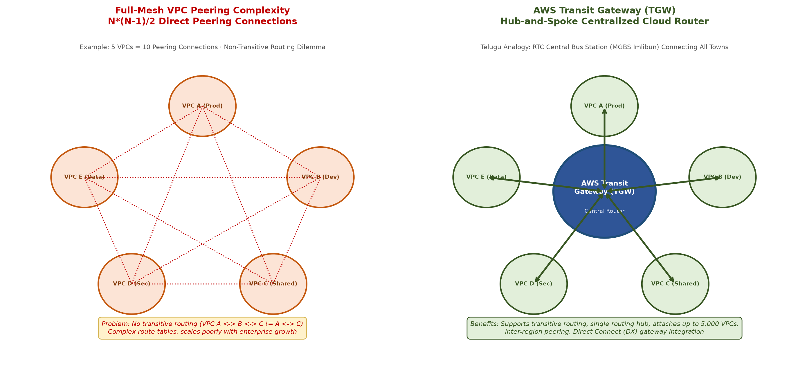

#### The Mathematical Problem of Full Mesh Peering:
The number of peering connections required to fully interconnect $N$ VPCs is defined by the combinatorial formula:
$$\text{Connections} = \frac{N \times (N - 1)}{2}$$

* For 5 VPCs: $\frac{5 \times 4}{2} = 10$ peering connections.
* For 20 VPCs: $\frac{20 \times 19}{2} = 190$ peering connections.
* For 100 VPCs: $\frac{100 \times 99}{2} = 4,950$ peering connections!

Managing 4,950 peering connections across hundreds of route tables with individual security group rules is impossible to operate or audit.

#### The Telugu Analogy: MGBS Imlibun Bus Station (Hyderabad)
Imagine if the Telangana State Road Transport Corporation (TSRTC) built separate, dedicated express highways connecting every single town to every other town:
* A direct highway from Adilabad to Nalgonda.
* A direct highway from Nalgonda to Nizamabad.
* A direct highway from Mahbubnagar to Warangal.
* A direct highway from Khammam to Karimnagar...

Telangana would be covered in thousands of redundant, expensive roads.
Instead, TSRTC built **MGBS (Mahatma Gandhi Bus Station at Imlibun, Hyderabad)** as the central hub. Every bus from every district drives to MGBS. At MGBS, passengers switch platforms and take another bus to their destination.

**AWS Transit Gateway (TGW)** is the cloud's MGBS:
* It functions as a massive, cloud-scale Layer 3 virtual router.
* Each VPC attaches to the Transit Gateway via a single attachment.
* TGW supports **transitive routing**: VPC A can communicate with VPC C through the Transit Gateway!
* Integrates directly with AWS Site-to-Site VPN and AWS Direct Connect, allowing all 100 VPCs to access on-premises corporate headquarters through a single physical connection.

---

### VPC Reachability Analyzer & Common Networking Mistakes Matrix

AWS provides the **VPC Reachability Analyzer**, a formal configuration analysis tool that tests network path reachability between a source and destination resource (e.g., an EC2 instance and an RDS database, or an ALB and an EC2 instance) **without sending actual packets over the wire**.

It inspects route tables, security groups, network ACLs, and NAT gateways mathematically, reporting the exact hop where traffic is blocked (e.g., *"Security Group `sg-01a2` does not allow inbound TCP port 5432 from `10.0.1.15`"*).

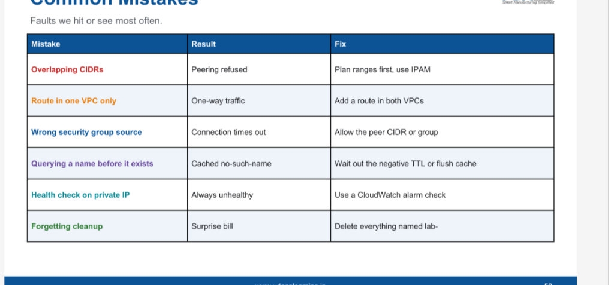

#### Common Mistakes Matrix Explained:

| Mistake | Immediate Operational Result | Root Cause Analysis | Engineering Production Fix |
| :--- | :--- | :--- | :--- |
| **Overlapping CIDRs** | VPC Peering creation **refused** by AWS Console / API. | Both VPCs were provisioned with conflicting IP ranges (e.g., both use `10.0.0.0/16`). | Adopt centralized IPAM (AWS IP Address Manager) to allocate non-overlapping CIDR pools (`10.1.0.0/16`, `10.2.0.0/16`). |
| **Route in One VPC Only** | One-way traffic failure; connections hang indefinitely. | Route table in VPC A points to `pcx-1`, but route table in VPC B has no return route for VPC A's CIDR. | Add bidirectional route table entries in both VPC route tables pointing to the peering connection ID. |
| **Wrong Security Group Source** | Connection times out (TCP SYN retransmits, no response). | Target instance Security Group allows port 80/443 only from `0.0.0.0/0`, but internal traffic arrives with private IP `10.1.x.x`. | Update target Security Group inbound rule to authorize the specific peer VPC CIDR block or reference peer Security Group ID. |
| **Querying a Name Before It Exists** | Negative caching (`NXDOMAIN`) persists for minutes/hours. | Developer runs `curl newservice.internal` before Route 53 DNS record creation completes. Resolvers cache the "not found" response. | Wait out the Route 53 Negative Cache TTL (defined in SOA record, typically 300s) or flush local resolver cache (`ipconfig /flushdns`). |
| **Health Check on Private IP** | Route 53 health check reports target **Always Unhealthy**. | Standard Route 53 Public Health Check checkers reside on the public Internet and cannot reach private RFC 1918 IP addresses (`10.x.x.x`). | Create a CloudWatch Metric Health Check that triggers based on an internal ELB `HealthyHostCount` or EC2 metric alarm. |
| **Forgetting Cleanup** | Massive surprise bill at the end of the month! | NAT Gateways ($0.045/hr), Transit Gateways ($0.05/hr), and Provisioned EBS volumes left running after a 1-hour student lab. | Execute an aggressive teardown script immediately after lab completion. Tag all training resources `Environment=Lab` and run auto-cleanup. |

---

## 3. Route 53 DNS, The Global Internet & Cryptographic HTTPS Transport

### How DNS Resolution Works: Recursive to Authoritative

The Domain Name System (DNS) is the global directory that translates human-friendly domain names (`task.telangana.gov.in`) into machine-readable IP addresses (`13.232.100.42`).

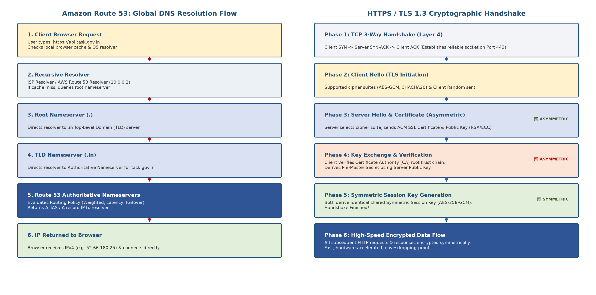

When a client queries a domain name:
1. **Client / Browser Cache:** The browser checks its internal cache (Chrome: `chrome://net-internals/#dns`) and the local operating system hosts file / DNS cache.
2. **Recursive Resolver:** If not cached, the client sends a recursive query to its configured recursive DNS resolver (e.g., Airtel/Jio ISP DNS, Google `8.8.8.8`, or AWS Route 53 Resolver at `VPC IPv4 base + 2`, e.g., `10.0.0.2`).
3. **Root Nameservers (`.`):** If the recursive resolver does not have the answer, it contacts one of the 13 global root server clusters (named `a.root-servers.net` through `m.root-servers.net`), asking: *"Who owns `.in`?"*. The root server returns the TLD nameservers for `.in`.
4. **TLD Nameservers (`.in`):** The recursive resolver queries the `.in` Top-Level Domain registry nameservers, asking: *"Who owns `telangana.gov.in`?"*. The TLD server returns the authoritative nameservers.
5. **Authoritative Nameservers (Route 53 Hosted Zone):** The recursive resolver queries Amazon Route 53 nameservers (e.g., `ns-123.awsdns-45.com`), which hold the official, published DNS records. Route 53 returns the final IP address (`13.232.100.42`) along with a **Time to Live (TTL)** value.
6. **Caching:** The recursive resolver caches the result for the duration of the TTL (e.g., 300 seconds) and hands the IP address to the client.

---

### Route 53 Record Types & The Zone Apex ALIAS Advantage

Route 53 supports standard IETF DNS records alongside AWS-exclusive features:

* **A Record:** Maps a hostname directly to an IPv4 address (`api.example.com` -> `13.232.14.88`).
* **AAAA Record:** Maps a hostname to an IPv6 address (`api.example.com` -> `2406:da1a:...`).
* **CNAME Record (Canonical Name):** Maps a hostname to another hostname (`www.example.com` -> `lb-1234.ap-south-1.elb.amazonaws.com`).
  * *The RFC 1034 / 1035 Limitation:* A CNAME record **cannot** be created for the **Zone Apex** (the root naked domain, e.g., `example.com`). It can only be used for subdomains (`www`, `api`, `blog`).
* **Route 53 ALIAS Record (The AWS Superpower):**
  * AWS invented the **ALIAS** record type to overcome the CNAME Zone Apex limitation.
  * An ALIAS record can map the Zone Apex (`example.com`) directly to AWS resources whose IP addresses change dynamically, including:
    * AWS Application Load Balancers / Network Load Balancers
    * Amazon CloudFront Distributions
    * Amazon S3 Static Website Buckets
    * AWS Elastic Beanstalk environments
  * *Cost Advantage:* AWS **does not charge for DNS queries** made to Route 53 ALIAS records that point to AWS resources! Standard DNS queries to CNAME or A records cost $0.40 per million queries.

---

### The Six Route 53 Routing Policies In-Depth

Route 53 provides sophisticated traffic-steering intelligence beyond simple static IP lookups:

```
┌────────────────────────────────────────────────────────────────────────────────────────┐
│                          ROUTE 53 ROUTING POLICIES MATRIX                              │
├──────────────────────┬──────────────────────────────────┬──────────────────────────────┤
│ Policy Name          │ Architectural Mechanics          │ Enterprise Use Case          │
├──────────────────────┼──────────────────────────────────┼──────────────────────────────┤
│ 1. Simple Routing    │ Returns one or more static IP    │ Single web server or default │
│                      │ addresses in random order. No    │ non-redundant development    │
│                      │ health checks supported.         │ environment.                 │
├──────────────────────┼──────────────────────────────────┼──────────────────────────────┤
│ 2. Weighted Routing  │ Splits traffic across endpoints  │ Canary deployments (90% to   │
│                      │ based on assigned percentages    │ Prod v1, 10% to Canary v2)   │
│                      │ (e.g., 80% to Pool A, 20% Pool B)│ or gradual system migrations.│
├──────────────────────┼──────────────────────────────────┼──────────────────────────────┤
│ 3. Latency-Based     │ Directs users to the AWS region  │ Global latency minimization  │
│    Routing           │ that offers the lowest network   │ for international users in   │
│                      │ round-trip latency for that user.│ Mumbai, Singapore, Frankfurt.│
├──────────────────────┼──────────────────────────────────┼──────────────────────────────┤
│ 4. Failover Routing  │ Active-Passive disaster recovery.│ High Availability DR: Route  │
│                      │ Routes to Primary; if health check│ to Primary Region; flip to   │
│                      │ fails, automatically flips to DR.│ Static S3 DR site on outage. │
├──────────────────────┼──────────────────────────────────┼──────────────────────────────┤
│ 5. Geolocation       │ Routes traffic based on the      │ Regulatory compliance (EU    │
│    Routing           │ geographic location of the user  │ users to Dublin for GDPR;    │
│                      │ (Continent, Country, US State).  │ Indian users to Mumbai).     │
├──────────────────────┼──────────────────────────────────┼──────────────────────────────┤
│ 6. Multi-Value       │ Returns up to 8 healthy records  │ Poor-man's client-side load  │
│    Answer Routing    │ chosen randomly. Checks health of│ balancing across web servers │
│                      │ every endpoint before returning. │ without deploying an ELB.    │
└──────────────────────┴──────────────────────────────────┴──────────────────────────────┘
```

---

### Public vs. Private Hosted Zones (Split-View DNS)

* **Public Hosted Zone:** Records are publicly accessible from anywhere on the global Internet. Anyone on a mobile phone or home laptop can query `task.telangana.gov.in`.
* **Private Hosted Zone:** Records are completely invisible to the outside Internet. The hosted zone is associated with one or more specific VPCs. Only EC2 instances and containers running inside those associated VPCs can resolve names like `database.internal.task` to private IP `10.0.2.15`.
* **Split-View (Split-Horizon) DNS:** An enterprise can create a Public Hosted Zone AND a Private Hosted Zone with the exact same domain name (`example.com`). Outside users resolving `example.com` receive the public IP of the CloudFront CDN distribution; internal VPC instances resolving `example.com` receive the private IP of an internal load balancer!

---

### How HTTPS & TLS 1.3 Work: Asymmetric Handshake & Symmetric Session Data

A common misconception among beginner cloud engineers is that HTTPS uses asymmetric encryption for the entire communication. Asymmetric cryptography is computationally expensive and would bottleneck web servers.

HTTPS combines **Asymmetric Cryptography** (for authentication and key exchange) with **Symmetric Cryptography** (for ultra-fast payload data transfer):

```
┌────────────────────────────────────────────────────────────────────────────────────────┐
│                        TLS 1.3 CRYPTOGRAPHIC HANDSHAKE FLOW                           │
└────────────────────────────────────────────────────────────────────────────────────────┘

 CLIENT BROWSER                                                   ALB / WEB SERVER
      │                                                                  │
      │ 1. ClientHello (Supported Ciphers, Client Random, ECDHE Share)   │
      │─────────────────────────────────────────────────────────────────>│
      │                                                                  │
      │ 2. ServerHello (Selected Cipher, Server Random, ECDHE Share,     │
      │    Encrypted X.509 ACM Certificate, CertificateVerify, Finished) │
      │<─────────────────────────────────────────────────────────────────│
      │                                                                  │
  [Client validates ACM Certificate against CA root store]               │
  [Both independently compute identical Master Secret via ECDHE math]   │
      │                                                                  │
      │ 3. Client Finished                                               │
      │─────────────────────────────────────────────────────────────────>│
      │                                                                  │
  ========================================================================
             ESTABLISHED: 100% SYMMETRIC ENCRYPTED SESSION
     (Ultra-Fast AES-256-GCM / ChaCha20-Poly1305 Wire Encryption)
  ========================================================================
      │                                                                  │
      │ 4. HTTP GET /api/v1/students [Encrypted Application Data]        │
      │─────────────────────────────────────────────────────────────────>│
      │ 5. HTTP 200 OK (Payload JSON) [Encrypted Application Data]       │
      │<─────────────────────────────────────────────────────────────────│
```

1. **The Asymmetric Phase (Handshake):**
   * The server possesses an **Asymmetric Key Pair**: a **Public Key** (embedded inside the X.509 SSL Certificate presented to the world) and a securely guarded **Private Key** (stored inside AWS Certificate Manager / KMS).
   * The client verifies the authenticity of the server's public certificate against trusted Certificate Authorities (CAs).
   * Using **ECDHE (Elliptic Curve Diffie-Hellman Ephemeral)** key exchange, the client and server exchange public parameters over the untrusted network. Through advanced mathematical properties of elliptic curves, both sides independently calculate an identical **Shared Secret (Symmetric Session Key)** without ever transmitting the secret across the wire!

2. **The Symmetric Phase (Bulk Data Transfer):**
   * Once the shared session key is computed, the asymmetric keys are no longer used for data transmission.
   * All subsequent HTTP requests and responses (passwords, cookies, HTML, images) are encrypted and decrypted using **Symmetric Encryption (AES-256-GCM or ChaCha20-Poly1305)**.
   * *Why?* Symmetric hardware acceleration (AES-NI instructions built into modern Intel/AMD/Graviton CPU chips) encrypts gigabytes of data per second with virtually zero CPU overhead!

---

## 4. 4.3a Elastic Load Balancing (ELB) Deep Dive

In production architectures, a single EC2 instance cannot handle millions of concurrent users, nor does it provide fault tolerance. If that single instance dies, your business goes offline.

**AWS Elastic Load Balancing (ELB)** automatically distributes incoming application traffic across multiple compute targets (Amazon EC2 instances, ECS Docker containers, AWS Lambda functions, and IP addresses) across multiple Availability Zones.

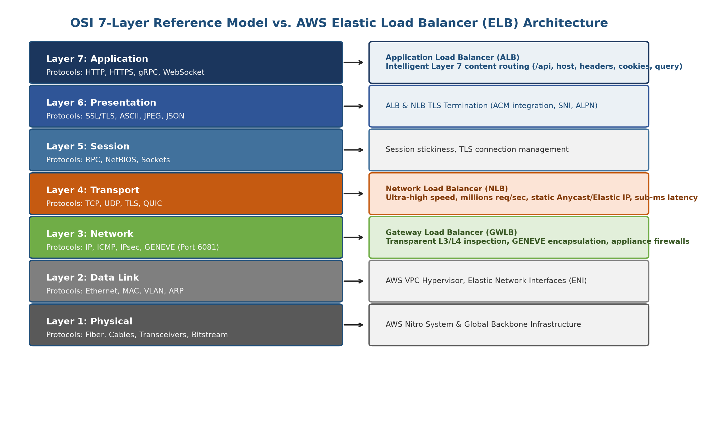

### OSI 7-Layer Reference Model vs. AWS Load Balancers

To select the correct load balancer, an engineer must map AWS ELB offerings directly to the Open Systems Interconnection (OSI) 7-Layer Model:

1. **Layer 7: Application Layer (HTTP, HTTPS, gRPC, WebSocket):**
   * **Application Load Balancer (ALB):** Inspects the contents of the application packet. It understands HTTP headers, cookies, URL paths, and query parameters.
2. **Layer 6: Presentation Layer (TLS/SSL Encryption):**
   * Both ALB and NLB terminate TLS certificates using AWS Certificate Manager (ACM), offloading cryptographic strain from backend application servers.
3. **Layer 4: Transport Layer (TCP, UDP, TLS):**
   * **Network Load Balancer (NLB):** Operates purely on IP packets, TCP/UDP ports, and sequence numbers. It does not inspect HTTP payloads. Delivers ultra-high speed and sub-millisecond latencies.
4. **Layer 3: Network Layer (IP Packets, Routing, GENEVE Tunneling):**
   * **Gateway Load Balancer (GWLB):** Deploys, scales, and manages a fleet of third-party inline security appliances (firewalls, deep packet inspection, intrusion detection systems) using GENEVE encapsulation on UDP port 6081.

---

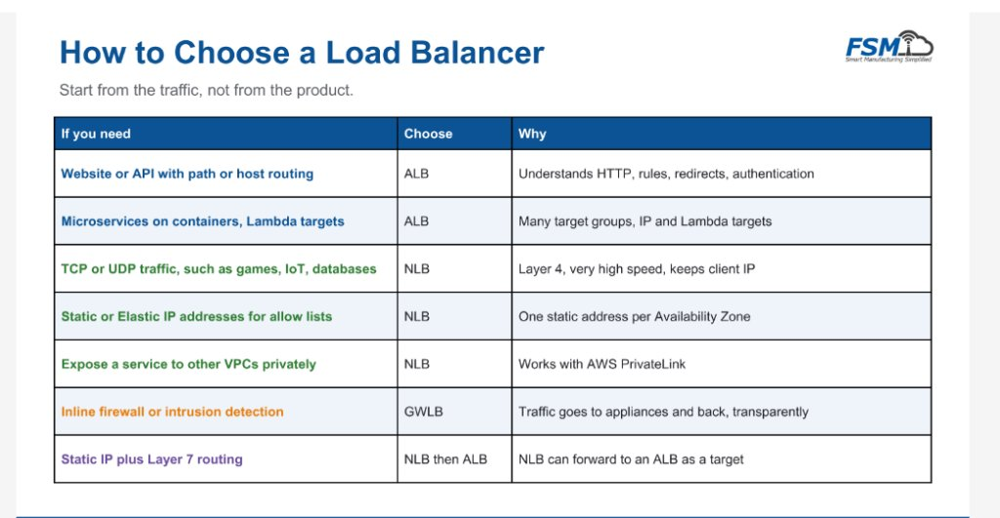

### How to Choose a Load Balancer: Architectural Decision Matrix

The following decision matrix provides unambiguous architectural guidance for any workload:

| Workload Requirement | Load Balancer Choice | Architectural Justification |
| :--- | :--- | :--- |
| **Website or REST API with path or host routing** | **ALB** | Understands HTTP/HTTPS, path rules (`/api` vs `/static`), host headers, HTTP redirects, and native OpenID Connect (OIDC) user authentication. |
| **Microservices on containers or Lambda targets** | **ALB** | Supports path-based routing across dozens of dynamic Target Groups; native target support for IP addresses and AWS Lambda functions. |
| **TCP or UDP traffic (Gaming servers, IoT, Databases)** | **NLB** | Operates at Layer 4; extreme performance handling millions of requests per second with sub-millisecond latency; preserves raw client IP. |
| **Static or Elastic IP addresses for client allow lists** | **NLB** | Provides exactly one permanent Static IP or Elastic IP per enabled Availability Zone. Ideal for enterprise B2B firewalls requiring hardcoded IPs. |
| **Expose a service to other VPCs privately** | **NLB** | Functions as the native backend service engine for **AWS PrivateLink** (VPC Endpoint Services). |
| **Inline firewall or intrusion detection (IDS/IPS)** | **GWLB** | Intercepts all VPC ingress/egress traffic transparently, routes through third-party firewall appliances, and returns traffic to destination. |
| **Static IP requirement + Layer 7 path routing** | **NLB in front of ALB** | The NLB provides the static Elastic IP front door and forwards traffic directly to an Application Load Balancer target group for Layer 7 URL routing! |

---

### Application Load Balancer (ALB): Layer 7 Intelligent Content Routing

An Application Load Balancer consists of three architectural building blocks:

```
┌────────────────────────────────────────────────────────────────────────────────────────┐
│                     ALB LAYER 7 LISTENER RULES & TARGET GROUPS                         │
└────────────────────────────────────────────────────────────────────────────────────────┘

                                CLIENT TRAFFIC
                                      │
                                      ▼
                        ┌───────────────────────────┐
                        │  ALB Listener (Port 443)  │
                        └─────────────┬─────────────┘
                                      │
               ┌──────────────────────┼──────────────────────┐
               │                      │                      │
   Path = /api/*              Host = orders.com       Default Rule
               ▼                      ▼                      ▼
        ┌─────────────┐        ┌─────────────┐        ┌─────────────┐
        │Target Group1│        │Target Group2│        │Target Group3│
        │ [ECS API]   │        │ [Order EC2] │        │ [Web Frontend]
        └─────────────┘        └─────────────┘        └─────────────┘
```

1. **Listeners:** A listener checks for connection requests on a configured port and protocol (e.g., HTTPS on port 443).
2. **Listener Rules:** Priority-ordered rules that evaluate HTTP request attributes:
   * **Host-Based Routing:** `api.example.com` -> Forward to Target Group A; `orders.example.com` -> Forward to Target Group B.
   * **Path-Based Routing:** `/images/*` -> Forward to Target Group S3/CDN; `/checkout/*` -> Forward to Target Group EC2.
   * **HTTP Header / Method Routing:** `HTTP Method = POST` -> Forward to Write Cluster; `HTTP Method = GET` -> Forward to Read Cluster.
   * **Redirect Actions:** Automatically redirect HTTP (Port 80) to HTTPS (Port 443) with an HTTP 301 Permanent Redirect.
   * **Fixed-Response Actions:** Return custom HTTP 403 Forbidden or maintenance HTML messages directly from the ALB without touching backend servers!
3. **Target Groups:** Logical groupings of targets (EC2 instances, ECS containers, Lambda functions, or private IP addresses) that receive traffic. Each Target Group defines its own **Health Check path** (e.g., `GET /healthz`, expecting HTTP 200).

#### ALB Routing Algorithms:
* **Round Robin (Default):** Requests are distributed sequentially across all healthy targets in the target group.
* **Least Outstanding Requests (LOR):** The ALB routes the incoming request to the target that currently has the lowest number of unfinished, active in-flight requests.
  * *Best Practice:* Use Least Outstanding Requests for workloads with variable processing times (e.g., machine learning inference or complex SQL reporting where some requests take 5ms and others take 4 seconds). LOR prevents slow queries from bunching up on a single server.

#### Sticky Sessions (Session Affinity):
* By default, each request from a client is routed independently to any healthy target.
* Enabling **Sticky Sessions** forces the ALB to route all subsequent requests from the same user to the exact same backend EC2 instance using an HTTP cookie.
* Supported via **Duration-based Cookies** (generated by the ALB, configurable from 1 second to 7 days) or **Application-based Cookies** (custom cookie generated by your backend application code).
* *Architectural Warning:* Sticky sessions can cause load imbalance if a subset of users generate massive traffic, overloading one specific server while others sit idle. The preferred modern cloud architecture is **stateless applications** storing session state in Amazon ElastiCache (Redis).

#### Server Name Indication (SNI):
* Solves the problem of hosting multiple secure websites on a single Application Load Balancer.
* In older systems, one load balancer listener on port 443 could bind only one SSL/TLS certificate.
* **SNI** allows the client browser to send the requested hostname (`Host: payment.example.com`) during the initial TLS handshake *before* the server certificate is sent.
* The ALB inspects the SNI extension and serves the exact matching ACM certificate from its bound certificate list!

---

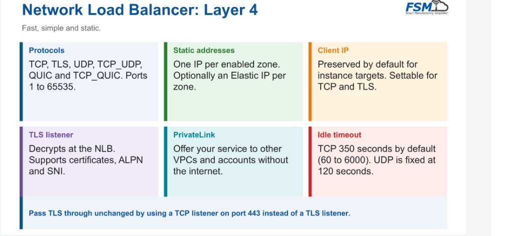

### Network Load Balancer (NLB): Layer 4 Extreme Performance & Static IPs

A Network Load Balancer operates at Layer 4 of the OSI model. It is engineered to process volatile, bursty traffic patterns scaling to **tens of millions of requests per second** while maintaining ultra-low sub-millisecond latencies.

#### Key Architectural Characteristics of NLB:
1. **Protocols Supported:** TCP, TLS, UDP, TCP_UDP combined, QUIC, and TCP_QUIC across all ports from 1 to 65535.
2. **Static & Elastic IP Addresses:**
   * Unlike an ALB (which has dynamic IP addresses and must always be referenced via DNS name), an NLB provides **one static private IP per enabled Availability Zone**.
   * You can associate a dedicated **Elastic IP (Public Static IP)** to each AZ. External enterprise clients with strict outbound corporate firewall rules can whitelist these static IP addresses permanently.
3. **Client IP Preservation:**
   * When using target type `instance`, the NLB preserves the original client source IP address directly in the IP packet header arriving at the EC2 instance! The backend sees the real customer IP without needing `X-Forwarded-For` HTTP headers.
4. **TLS Termination vs. TLS Pass-Through:**
   * *TLS Listener:* Decrypts traffic at the NLB using ACM certificates, supporting ALPN (Application-Layer Protocol Negotiation) and SNI.
   * *TCP Pass-Through:* By configuring a TCP listener on port 443 instead of a TLS listener, the NLB passes the raw, encrypted ciphertext packets directly to the backend EC2 instances without decrypting them. This satisfies strict government or banking compliance requirements where cloud infrastructure cannot hold decryption keys.
5. **AWS PrivateLink Engine:** NLB is the mandatory foundational component required to publish a service as an AWS PrivateLink endpoint service.
6. **Connection Idle Timeouts:** TCP connections have a default idle timeout of 350 seconds (configurable from 60 to 6000 seconds). UDP connections have a fixed idle timeout of 120 seconds.

---

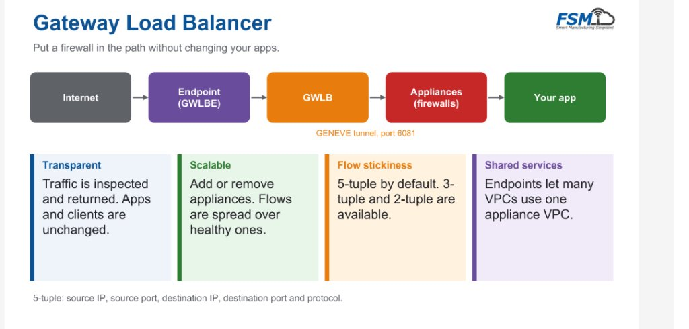

### Gateway Load Balancer (GWLB): Transparent Inline Security Appliance Fleet

Enterprises frequently need to run fleets of third-party network firewalls (e.g., Palo Alto Networks, Fortinet, Check Point, Cisco) to perform Deep Packet Inspection (DPI), Intrusion Prevention (IPS), and advanced URL filtering on all traffic entering and leaving their AWS environment.

Traditionally, deploying inline firewalls required complex, fragile routing hacks (multiple network interfaces, complex policy-based routing, and SNAT).

#### How Gateway Load Balancer Works:
1. **Single Entry Point:** User traffic enters the VPC via a **Gateway Load Balancer Endpoint (GWLBE)**.
2. **Transparent Inspection:** The GWLB intercepts the IP packets and encapsulates them using the **GENEVE protocol on UDP port 6081**.
3. **Firewall Processing:** The encapsulated packet is sent to a healthy firewall appliance in the appliance target group. The firewall decapsulates the GENEVE header, inspects the raw payload, verifies safety, re-encapsulates it, and sends it back to the GWLB.
4. **Delivery to Application:** If the firewall approves the packet, the GWLB delivers it to your application server. The application server and the original client have no idea the packet was intercepted—all IP headers, ports, and metadata remain completely unchanged!
5. **Flow Stickiness:** Supports **5-tuple stickiness** by default (Source IP, Source Port, Destination IP, Destination Port, Protocol) to ensure both directions of a two-way TCP conversation are routed to the exact same firewall appliance. 3-tuple and 2-tuple stickiness options are also available.
6. **Centralized Appliance VPC:** Multiple spoke VPCs can share a single centralized security appliance VPC via GWLB Endpoints, drastically slashing enterprise firewall licensing costs.

---

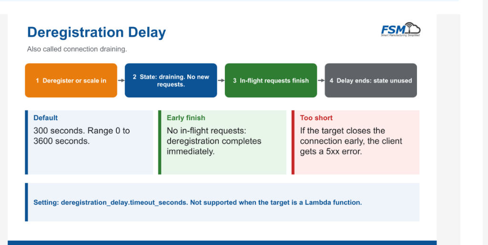

### Connection Draining / Deregistration Delay Deep Dive

When an Auto Scaling Group scales in (terminating an EC2 instance), or when an engineer manually deregisters an unhealthy target from a Target Group, what happens to the clients currently in the middle of completing a transaction?

If the load balancer immediately terminated the connection or killed the instance, users submitting credit card payments would experience broken TCP sockets and HTTP 502/504 errors.

**Deregistration Delay (also known as Connection Draining)** ensures zero-downtime target maintenance:

```
┌────────────────────────────────────────────────────────────────────────────────────────┐
│                        CONNECTION DRAINING / DEREGISTRATION DELAY                      │
└────────────────────────────────────────────────────────────────────────────────────────┘

 [Step 1: Event Trigger]      Target is marked for Deregistration or ASG Scale-In
            │
            ▼
 [Step 2: Draining State]     State changes to "DRAINING". Load balancer immediately
                              STOPS sending any NEW requests to this target.
            │
            ▼
 [Step 3: In-Flight Grace]    Existing in-flight requests are allowed to finish cleanly.
                              Keep-alive connections complete their active responses.
            │
            ▼
 [Step 4: Delay Timeout]      Deregistration Delay timer expires (or in-flight drops to 0).
                              Target state transitions to "UNUSED". Instance is safely
                              terminated or removed.
```

#### Key Technical Parameters:
* **Attribute Setting:** `deregistration_delay.timeout_seconds`.
* **Default Value:** **300 seconds** (5 minutes).
* **Configurable Range:** **0 to 3600 seconds** (0 seconds to 1 hour).
* **Early Finish Optimization:** If the target finishes all active in-flight requests and has zero active TCP connections before the timer expires, the load balancer deregisters the instance **immediately** without waiting for the full 300 seconds!
* **The "Too Short" Hazard:** If an architect configures `deregistration_delay.timeout_seconds = 5` for an application that processes 30-second PDF generation reports, active connections will be violently severed, resulting in HTTP 5xx errors for end users.
* *Note:* Deregistration delay is **not supported** when the target type is an AWS Lambda function.

---

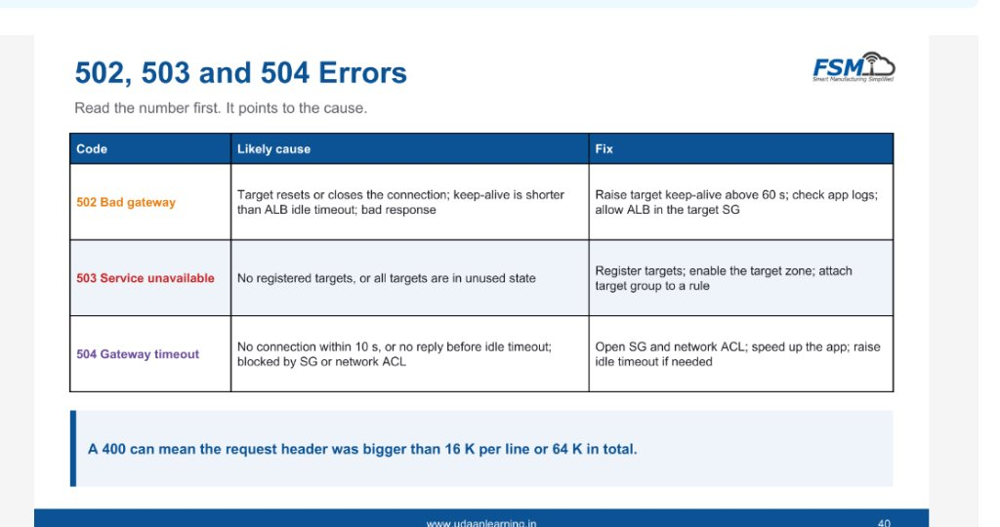

### ELB Troubleshooting Master Guide: HTTP 502, 503, 504 & 400 Root Causes

When production outages occur, a Senior Solutions Architect must rapidly isolate whether the fault lies in the DNS layer, the Load Balancer layer, the Security Group firewall, or the backend application runtime.

#### The Big Three Error Codes Matrix:

```
┌────────────────────────────────────────────────────────────────────────────────────────┐
│                      ELB PRODUCTION TROUBLESHOOTING CHEAT SHEET                        │
├──────────┬─────────────────────────┬───────────────────────────────────────────────────┤
│ Error    │ Meaning                 │ Most Common Real-World Root Causes                │
├──────────┼─────────────────────────┼───────────────────────────────────────────────────┤
│ HTTP 502 │ Bad Gateway             │ • Backend web server crashed or process died.     │
│          │ (Target responded       │ • Target closed TCP connection before response.   │
│          │ unexpectedly or broke   │ • Web server keep-alive timeout < ALB timeout.    │
│          │ protocol rules)         │ • Target returned response headers > 64 KB.       │
├──────────┼─────────────────────────┼───────────────────────────────────────────────────┤
│ HTTP 503 │ Service Unavailable     │ • Target Group has ZERO healthy targets.          │
│          │ (Load balancer cannot   │ • Target health checks failing across all AZs.    │
│          │ find any target to route│ • Target group queue capacity is full (spillover).│
│          │ the request to)         │                                                   │
├──────────┼─────────────────────────┼───────────────────────────────────────────────────┤
│ HTTP 504 │ Gateway Timeout         │ • Backend database query taking > 60s (deadlock). │
│          │ (Target took too long to│ • ALB idle timeout (60s) reached before response. │
│          │ reply back to the ELB)  │ • Backend instance CPU pegged at 100% saturation. │
├──────────┼─────────────────────────┼───────────────────────────────────────────────────┤
│ HTTP 400 │ Bad Request             │ • Client sent malformed HTTP request syntax.      │
│          │ (Client error caught by │ • HTTP header size exceeded ALB limits (16 KB).   │
│          │ ALB parser)             │ • Missing mandatory Host header in HTTP/1.1.      │
└──────────┴─────────────────────────┴───────────────────────────────────────────────────┘
```

#### Detailed Diagnostic & Remediation Playbook:

1. **HTTP 502 Bad Gateway Deep Dive:**
   * *Root Cause 1: Keep-Alive Race Condition (The #1 Production Bug):*
     By default, an ALB maintains idle TCP connections to targets for **60 seconds**. Many web servers (Apache, Nginx, Node.js) have a default keep-alive timeout of 5 seconds or 65 seconds. If the backend web server closes the TCP socket at the exact instant the ALB sends a new request, the ALB receives a TCP RST (Reset) packet and immediately emits an HTTP 502 to the client.
     *Fix:* Configure your backend web server keep-alive timeout to **at least 65 to 75 seconds** (always higher than the ALB's 60-second idle timeout).
     ```nginx
     # Nginx Configuration Fix (/etc/nginx/nginx.conf)
     keepalive_timeout 75s;
     ```
   * *Root Cause 2: Response Header Overflow:*
     If your application sets excessive cookies or debug headers exceeding **64 KB**, the ALB parser rejects the target response and returns an HTTP 502.

2. **HTTP 503 Service Unavailable Deep Dive:**
   * *Root Cause 1: All Targets Failing Health Checks:*
     Navigate to the AWS Console -> EC2 -> Target Groups -> Target Health. If all targets show `Unhealthy`:
     * Check instance Security Group: Does it allow inbound traffic from the ALB's Security Group on the target port?
     * Check health check path: Is the health check pinging `/` and receiving an HTTP 404 or 301 redirect? (By default, health checks expect HTTP 200). Change the matcher to `200-399` or point to a dedicated `/healthz` endpoint.
   * *Root Cause 2: Zero Targets Registered:*
     The Auto Scaling Group terminated all instances or has not finished launching new ones.

3. **HTTP 504 Gateway Timeout Deep Dive:**
   * *Root Cause 1: Database Query Deadlock:*
     A complex reporting SQL query is running on an unindexed Amazon RDS PostgreSQL table, taking 95 seconds. The ALB idle timeout is 60 seconds. At second 60.001, the ALB terminates the client connection and returns HTTP 504.
     *Fix:* Either increase the ALB idle timeout attribute (`idle_timeout.timeout_seconds = 120`), optimize the SQL query with proper indexes, or decouple the long-running task by offloading it to an **Amazon SQS queue and AWS Lambda worker**.

---

## 5. 4.4a Auto Scaling, ElastiCache & Cost Optimization

### Horizontal Scaling (Scale Out/In) vs. Vertical Scaling (Scale Up/Down)

When system load increases, an architect can scale compute in one of two directions:

```
┌────────────────────────────────────────────────────────────────────────────────────────┐
│                        HORIZONTAL vs. VERTICAL SCALING                                 │
├─────────────────────────┬──────────────────────────────┬───────────────────────────────┤
│ Architectural Dimension │ Vertical Scaling             │ Horizontal Scaling            │
│                         │ (Scale Up / Scale Down)      │ (Scale Out / Scale In)        │
├─────────────────────────┼──────────────────────────────┼───────────────────────────────┤
│ Core Mechanism          │ Increasing the CPU/RAM of a  │ Adding or removing identical  │
│                         │ single machine (e.g., from   │ server instances across       │
│                         │ `t3.medium` to `m5.4xlarge`) │ Availability Zones.           │
├─────────────────────────┼──────────────────────────────┼───────────────────────────────┤
│ Downtime Requirement    │ Requires instance STOP &     │ ZERO DOWNTIME. Instances spin │
│                         │ START (several minutes down).│ up and down dynamically.      │
├─────────────────────────┼──────────────────────────────┼───────────────────────────────┤
│ Physical Upper Limit    │ Hard hardware ceiling (e.g., │ Virtually infinite. You can   │
│                         │ largest EC2 instance: 448 vCPU)│ run 10,000 small instances. │
├─────────────────────────┼──────────────────────────────┼───────────────────────────────┤
│ Cost Efficiency         │ High per-unit cost; wasteful │ Highly cost-effective; scale  │
│                         │ during off-peak night hours. │ down to 1 instance at night.  │
├─────────────────────────┼──────────────────────────────┼───────────────────────────────┤
│ Fault Tolerance         │ SINGLE POINT OF FAILURE. If  │ HIGHLY FAULT-TOLERANT. If one │
│                         │ that one giant instance dies,│ instance dies, others continue│
│                         │ the entire company is down!  │ serving traffic seamlessly.   │
├─────────────────────────┼──────────────────────────────┼───────────────────────────────┤
│ Primary AWS Service     │ Changing EC2 Instance Type   │ Amazon EC2 Auto Scaling (ASG) │
└─────────────────────────┴──────────────────────────────┴───────────────────────────────┘
```

---

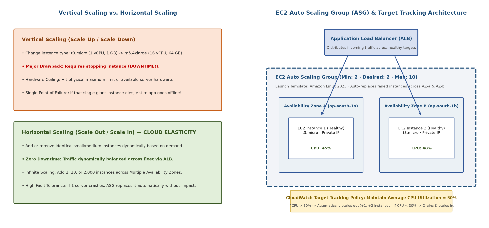

### EC2 Auto Scaling Groups (ASG) Mechanics & Scaling Policies

An Auto Scaling Group (ASG) is a collection of EC2 instances that are treated as a logical unit for automatic provisioning, health management, and dynamic scaling.

#### Core ASG Components:
1. **Launch Template (The Blueprint):**
   * Specifies the AMI ID (Amazon Linux 2023, Ubuntu), EC2 instance type (`t3.micro`), Key Pair, IAM Instance Profile, Security Groups, EBS block device mappings, and **User Data script** (shell script executing bootstrapping logic on initial boot).
   * Supports versioning (e.g., v1, v2, v3). You can update code by creating a new template version without rebuilding the ASG.
   * *Note:* Replaces legacy "Launch Configurations", which AWS has deprecated.
2. **Capacity Boundaries:**
   * **Minimum Size (Min):** The floor. ASG will never terminate instances below this number, even if traffic drops to zero.
   * **Desired Capacity:** The current number of running instances.
   * **Maximum Size (Max):** The ceiling. Protects against run-away AWS bills during DDoS attacks or infinite-loop scaling bugs.
3. **Multi-AZ Availability Balancing:**
   * An ASG should always span at least two or three Availability Zones (e.g., `ap-south-1a`, `ap-south-1b`).
   * The ASG automatically balances instance counts equally across all selected subnets. If `ap-south-1a` fails completely, the ASG detects the lost instances and automatically launches replacement instances in `ap-south-1b`!

#### The Four Auto Scaling Policy Types:
* **Target Tracking Scaling (Most Popular):**
  * You define a target metric value (e.g., *"Keep average aggregate CPU utilization at exactly 50%"* or *"Keep ALB RequestCountPerTarget at 1000"*).
  * The ASG acts like a home thermostat: it continuously computes the difference and adds or removes instances dynamically to hold the metric at the target.
* **Step Scaling:**
  * Defines discrete step adjustments based on CloudWatch alarm thresholds:
    * If CPU > 60% -> Add 1 instance.
    * If CPU > 80% -> Add 3 instances.
    * If CPU > 90% -> Add 5 instances.
* **Simple Scaling:**
  * Waits for a metric alarm, adjusts capacity by a single increment, and enters a mandatory **Cooldown Period** (default 300s) where no other scaling activities are permitted until metrics stabilize.
* **Predictive Scaling (Machine Learning):**
  * AWS ML algorithms analyze your historical traffic patterns over the preceding 14 days, forecast recurring daily or weekly traffic surges, and pre-warm instances 15 minutes before the surge hits!

#### ASG Termination Policies:
When an ASG scales in, it must decide which instance to terminate first:
1. Identify the Availability Zone with the highest number of instances.
2. Within that AZ, terminate the instance running the **Oldest Launch Template Version**.
3. If versions are identical, terminate the instance closest to the next billing hour.

---

### ElastiCache Deep Dive: Redis/Valkey vs. Memcached & Caching Patterns

Querying a relational database (Amazon RDS PostgreSQL/MySQL) requires disk reads, query parsing, and table locking. For high-throughput applications, the database rapidly becomes the primary architectural bottleneck.

**Amazon ElastiCache** provides an ultra-low latency, in-memory data store delivering sub-millisecond query responses directly from RAM:

```
┌────────────────────────────────────────────────────────────────────────────────────────┐
│                        ELASTICACHE: REDIS vs. MEMCACHED                                │
├─────────────────────────┬──────────────────────────────┬───────────────────────────────┤
│ Architectural Feature   │ Amazon ElastiCache for Redis │ Amazon ElastiCache for        │
│                         │ (and Valkey)                 │ Memcached                     │
├─────────────────────────┼──────────────────────────────┼───────────────────────────────┤
│ Data Structures         │ Rich types: Strings, Lists,  │ Simple Key-Value strings only │
│                         │ Sets, Sorted Sets, Hashes,   │ (Pure in-memory cache)        │
│                         │ Bitmaps, Geospatial, Streams │                               │
├─────────────────────────┼──────────────────────────────┼───────────────────────────────┤
│ Multi-Threading         │ Single-threaded core engine  │ Multi-threaded engine         │
│                         │ (Scales via multi-sharding)  │ (Scales vertically per core)  │
├─────────────────────────┼──────────────────────────────┼───────────────────────────────┤
│ Data Persistence        │ Full persistence supported   │ NO PERSISTENCE. If node dies, │
│                         │ (RDB snapshots & AOF logs)   │ all data in RAM is gone!      │
├─────────────────────────┼──────────────────────────────┼───────────────────────────────┤
│ High Availability       │ Multi-AZ with Automatic      │ No native replication. Cache  │
│                         │ Failover to Read Replicas    │ misses repopulate from DB.    │
├─────────────────────────┼──────────────────────────────┼───────────────────────────────┤
│ Advanced Capabilities   │ Pub/Sub messaging, Lua       │ Simple, lightweight caching   │
│                         │ scripts, Leaderboards, Redis │ of pre-rendered HTML fragments│
│                         │ Transactions, Geospatial     │ and database query results.   │
└─────────────────────────┴──────────────────────────────┴───────────────────────────────┘
```

#### The Cache-Aside (Lazy Loading) Architecture Pattern:
This is the most widely adopted enterprise caching pattern:

```
┌────────────────────────────────────────────────────────────────────────────────────────┐
│                          CACHE-ASIDE (LAZY LOADING) PATTERN                            │
└────────────────────────────────────────────────────────────────────────────────────────┘

                        ┌────────────────────────┐
                        │   Application Server   │
                        └───────────┬────────────┘
                                    │
                  1. Check Cache    │
                  Key: "user:101"   ▼
                        ┌────────────────────────┐
                        │      ElastiCache       │
                        │    (In-Memory RAM)     │
                        └───────────┬────────────┘
                                    │
           ┌────────────────────────┴────────────────────────┐
           ▼                                                 ▼
     [CACHE HIT]                                       [CACHE MISS]
 Data returned in 0.5ms                         Key not found in cache!
                                                             │
                                          2. Read from Disk  ▼
                                                ┌────────────────────────┐
                                                │   Amazon RDS (Disk)    │
                                                └────────────┬───────────┘
                                                             │
                                          3. Write to Cache  ▼
                                                ┌────────────────────────┐
                                                │ Save "user:101" in     │
                                                │ ElastiCache (TTL=3600s)│
                                                └────────────────────────┘
```

1. Application receives a request for user profile data (ID: `101`).
2. Application checks ElastiCache first: `GET user:101`.
3. **If Cache Hit:** Return data immediately to client (sub-millisecond latency). Database is never touched.
4. **If Cache Miss:** Application queries Amazon RDS PostgreSQL.
5. Application writes the returned record into ElastiCache with a **Time to Live (TTL)**: `SET user:101 <json_data> EX 3600`.
6. Subsequent requests for user `101` during the next hour result in instantaneous cache hits.

---

### Architectural Cost Engineering & Optimization Strategies

A well-architected cloud system must deliver optimal business performance at the lowest possible expenditure:

1. **Eliminate Unnecessary NAT Gateway Data Transfer Fees:**
   * A NAT Gateway costs $0.045 per hour + **$0.045 per GB processed**.
   * If an application running on 10 EC2 instances downloads 10 Terabytes of training datasets or logs from Amazon S3 through a NAT Gateway each month:
     $$\text{NAT Data Cost} = 10,000\text{ GB} \times \$0.045 = \$450.00/\text{month!}$$
   * *The Fix:* Provision a **VPC Gateway Endpoint for S3**. Cost: **$0.00**. Immediate monthly savings: **$450.00**.

2. **Leverage EC2 Spot Instances with ASG Mixed Instances Policies:**
   * Spot Instances offer up to a **90% discount** compared to On-Demand prices by utilizing spare AWS compute capacity.
   * *Strategy:* Configure your Auto Scaling Group with a **Mixed Instances Policy**:
     * Set a base capacity of 2 On-Demand instances (for guaranteed baseline availability).
     * Fulfill remaining scale-out capacity with 80% Spot Instances and 20% On-Demand across multiple instance families (`t3.medium`, `t4g.medium`, `c6g.medium`).
     * If AWS reclaims a Spot instance with a 2-minute warning, the ASG automatically launches a replacement from an alternate instance family.

3. **Deploy Graviton ARM Processors:**
   * Transitioning workloads from standard Intel/AMD x86 (`m5.large`) to AWS Graviton3/Graviton4 ARM-based instances (`m7g.large`) delivers up to **40% better price-performance** and reduces energy consumption by up to 60%.

4. **Multi-AZ vs. Single-AZ Cost Engineering:**
   * While Multi-AZ is mandatory for production high availability, deploying development, testing, and staging environments across multiple AZs generates unnecessary inter-AZ cross-data transfer fees ($0.01/GB).
   * Restrict non-production development environments to a single AZ, and shut them down automatically outside business hours (7:00 PM to 8:00 AM) using AWS Systems Manager Quick Setup or Instance Scheduler.

---

## 6. AWS Solutions Architect Certification & Real-World Interview Scenarios

### Scenario 1: The E-Commerce Flash Sale Architecture
* **Client Scenario:** A major Indian retail client expects 2 million concurrent shoppers to hit their website during an annual 3-hour midnight festival sale. The current monolithic system runs on a single large EC2 instance with a MySQL database on the same server, which crashed during the last sale.
* **Architectural Challenge:** Provide a zero-downtime, fault-tolerant, auto-scaling architecture on AWS.
* **Solution Architecture:**
  1. **DNS & Edge Acceleration:** Register domain on **Amazon Route 53** with an ALIAS record pointing to an **Amazon CloudFront** CDN distribution. CloudFront caches static CSS, JavaScript, and product catalog images at edge locations in Hyderabad, Mumbai, Bangalore, and Delhi.
  2. **Security Perimeter:** Attach **AWS WAF** to CloudFront with rate-limiting rules (e.g., block IPs making > 2000 requests/5 min) and bot control to stop automated scalpers.
  3. **Load Balancing:** CloudFront forwards dynamic API requests to an Internet-facing **Application Load Balancer (ALB)** spanning three Availability Zones.
  4. **Compute Layer:** ALB routes traffic to an **Auto Scaling Group** running EC2 instances across private subnets. Use **Target Tracking Scaling** configured on `ALBRequestCountPerTarget`. Utilize Launch Templates with Amazon Linux 2023 pre-baked AMIs for rapid boot times.
  5. **Caching & Session State:** Deploy **Amazon ElastiCache (Redis)** Multi-AZ cluster in the private data subnets. Store user shopping carts and session tokens in Redis to keep EC2 web servers completely stateless.
  6. **Database Layer:** Migrate MySQL to **Amazon Aurora MySQL Multi-AZ** cluster with a primary writer node and three Auto-Scaling Read Replicas across different AZs. Route heavy catalog read traffic to the Aurora Read-Only Endpoint.
  7. **Decoupled Order Processing:** When a customer clicks "Place Order", write the transaction message into an **Amazon SQS FIFO queue**. A fleet of background worker EC2 instances or AWS Lambda functions consumes messages from SQS at a controlled rate, guaranteeing no database lock exhaustion.

---

### Scenario 2: The Regulatory B2B Financial Integration
* **Client Scenario:** A FinTech payment processing company needs to establish a secure API connection with three public sector banks. The banks' network security officers state that bank core systems cannot connect to the public Internet, cannot permit outbound traffic to dynamic domain names, and require hardcoded, permanent static IP addresses.
* **Architectural Challenge:** How can the FinTech company host an elastic, auto-scaling container microservice while satisfying the banks' rigid static IP and private network requirements?
* **Solution Architecture:**
  1. Deploy a **Network Load Balancer (NLB)** in front of the payment microservice.
  2. Assign an **Elastic IP (EIP)** to each enabled Availability Zone of the NLB. Provide these exact three static public IP addresses to the banks for their outbound firewall whitelisting.
  3. For banks requiring completely private transport without traversing the public Internet:
     * Deploy **AWS PrivateLink**. Create an **Endpoint Service** fronted by the NLB.
     * Establish an **AWS Direct Connect** or **AWS Site-to-Site VPN** connection between the banks' on-premises data centers and an **AWS Transit Gateway**.
     * The banks provision an **Interface VPC Endpoint** inside their private network, communicating with the FinTech application entirely over private RFC 1918 IP addresses.

---

### Scenario 3: The Broken 502/504 Production Outage Call
* **Interview Question:** *"It is 2:00 AM. You receive an escalated P1 incident call stating that customers are receiving HTTP 504 Gateway Timeout errors when submitting checkout requests through the Application Load Balancer. Walk me through your step-by-step diagnostic procedure."*
* **Candidate Response:**
  1. **Examine CloudWatch ELB Metrics:** Immediately check `HTTPCode_ELB_504_Count` vs `HTTPCode_Target_504_Count`.
     * If `HTTPCode_ELB_504_Count` is spiking, the timeout is generated by the ALB itself because the backend instance failed to respond within `idle_timeout.timeout_seconds` (default 60s).
  2. **Inspect Target Health & Target Response Time:** Review `TargetResponseTime` and `HealthyHostCount`.
     * If response times have climbed to 60+ seconds, inspect backend EC2 instances and database metrics.
  3. **Check Database Metrics:** Review Amazon RDS CPU utilization, active connections, and `DiskQueueDepth`. Check for unindexed table locks or transaction deadlocks blocking checkout writes.
  4. **Check Backend Web Server Logs:** SSH into a target instance or inspect CloudWatch Logs for Nginx/Apache error logs (`upstream timed out (110: Connection timed out) while reading response header from upstream`).
  5. **Immediate Mitigation:** If the database is overwhelmed by traffic, temporarily enable a higher capacity instance tier on the database, adjust ALB idle timeout if legitimate long-running batch work is completing, or deploy an emergency SQS buffer in front of the payment processor.

---

## 7. Module 4 Hands-On Labs Architecture & Preparation Roadmap

To bridge theoretical mastery with hands-on enterprise competency, Module 4 includes four rigorous lab exercises designed to be executed in the AWS Management Console and AWS CLI:

```
┌────────────────────────────────────────────────────────────────────────────────────────┐
│                        MODULE 4 PRACTICAL LAB BLUEPRINTS                               │
├─────────────────────┬──────────────────────────────────────────────────────────────────┤
│ Lab Exercise        │ Core Hands-On Architecture & Implementation Focus                │
├─────────────────────┼──────────────────────────────────────────────────────────────────┤
│ **Lab 4.1b**        │ • Conducting a formal AWS Well-Architected Tool review.          │
│ AWS Well-Architected│ • Configuring AWS Budgets with zero-spend & 80% threshold alarms.│
│ & Cost Guardrails   │ • Setting up AWS Cost Anomaly Detection with SNS email alerts.   │
├─────────────────────┼──────────────────────────────────────────────────────────────────┤
│ **Lab 4.2b**        │ • Provisioning two non-overlapping VPCs (VPC A & VPC B).         │
│ Multi-VPC Peering   │ • Creating & accepting a VPC Peering Connection (`pcx`).         │
│ & Route 53 DNS      │ • Configuring bidirectional route tables & cross-VPC ping tests. │
│                     │ • Creating a Route 53 Private Hosted Zone with split-view DNS.   │
├─────────────────────┼──────────────────────────────────────────────────────────────────┤
│ **Lab 4.3b**        │ • Deploying an Application Load Balancer across two public subnets.│
│ Elastic Load        │ • Creating Target Groups with custom HTTP health checks.         │
│ Balancing (ALB/NLB) │ • Demonstrating path-based routing (`/api` vs `/web`).          │
│                     │ • Testing Deregistration Delay / Connection Draining live.       │
│                     │ • Simulating & diagnosing HTTP 502/503 health check outages.     │
├─────────────────────┼──────────────────────────────────────────────────────────────────┤
│ **Lab 4.4b**        │ • Building an EC2 Launch Template with an automated User Data Nginx.│
│ Auto Scaling Groups │ • Deploying a Multi-AZ Auto Scaling Group (Min=2, Desired=2, Max=6).│
│ & In-Memory Caching │ • Stress-testing CPU using the `stress` Linux utility.           │
│                     │ • Observing Target Tracking scale-out & cooldown mechanics live. │
│                     │ • Deploying an ElastiCache Redis cluster & verifying cache hits. │
└─────────────────────┴──────────────────────────────────────────────────────────────────┘
```

*(Detailed step-by-step student lab execution manuals for Labs 4.1b through 4.4b are provided in the `/lab_sheet/module_04/` directory).*

---
> **Document Status:** Complete Master Study Guide (Module 4 Parts 4.1a – 4.4a)  
> **Accompanying Document:** [MODULE_04_PART_4.5_KMS_SECRETS_MANAGER_SSM_NOTES.md](file:///F:/Task(%20Telangana%20)/Nalgonda/Projects/task/notes/module_04/MODULE_04_PART_4.5_KMS_SECRETS_MANAGER_SSM_NOTES.md) (Covers Data Security, AWS KMS, Secrets Manager & SSM Parameter Store).
