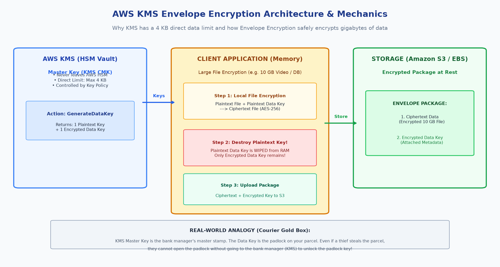
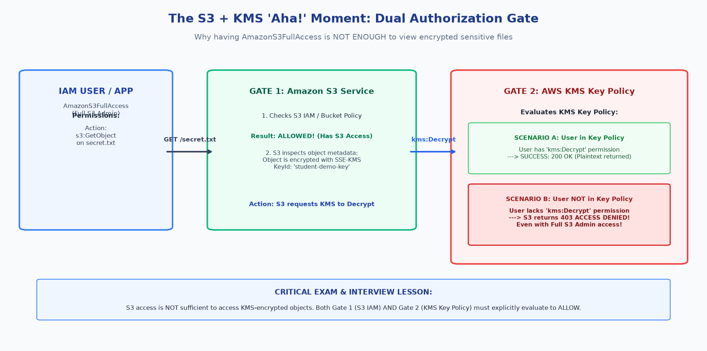
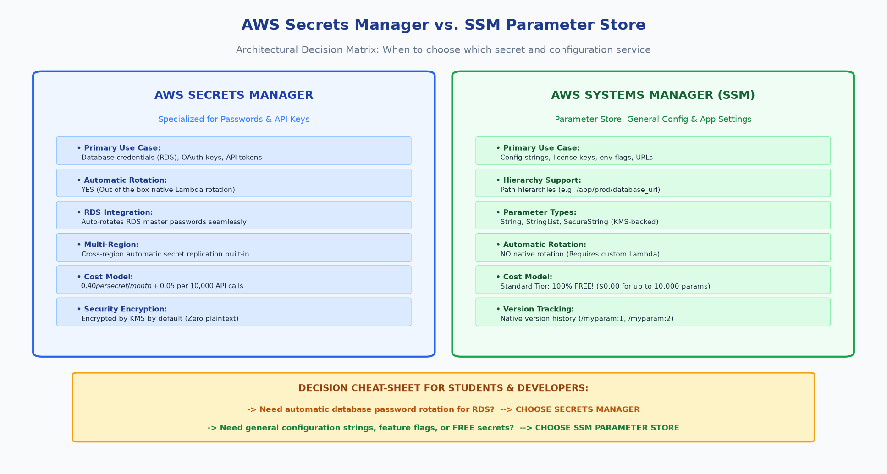

# AWS Module 4 (4.5a & 4.5b) — Data Security, AWS KMS, Secrets Manager & SSM Parameter Store
> **Program:** Telangana Academy for Skill and Knowledge (TASK)  
> **Course Track:** Cloud Software Developer (AWS Solutions Architect / Developer DVA-C02)  
> **Module Focus:** 4.5a (Data Security & Encryption Theory) & 4.5b (Hands-On Lab Sheet)  
> **Session Blueprint:** 30–40 Minutes Theory-Centric with Live Console Demonstration  
> **Trainer:** Sundeep Hiremat

---

## ⏱️ The 30–40 Minute Classroom Teaching Blueprint

| Time Block | Stage | Core Teaching Goal | Key Concept / Activity |
| :---: | :--- | :--- | :--- |
| **00–05 min** | **The Hook & The Analogy** | Explain why encryption matters; introduce the Bank Locker analogy | Storing plaintext passwords in S3/Git is dangerous; KMS as the Bank Vault Keeper |
| **05–13 min** | **KMS Architecture & Envelope Encryption** | Deconstruct KMS key types and the 4 KB limitation | AWS Owned vs. Managed vs. Customer Managed (CMKs); Envelope Encryption mechanics |
| **13–23 min** | **Live Console Demo ("Aha!" Moment)** | Prove that S3 Admin access != KMS Decrypt access | Create CMK, encrypt S3 file with SSE-KMS, remove `kms:Decrypt`, witness HTTP 403 Access Denied |
| **23–30 min** | **Secrets Manager vs. SSM Parameter Store** | Secrets lifecycle, auto-rotation, and hierarchical config | Auto-rotating RDS credentials vs. Free hierarchical config strings (`/app/prod/db_url`) |
| **30–35 min** | **Auditing, Rotation & Cost Optimization** | CloudTrail tracking, key rotation intervals, and cost traps | CMK costs $1/mo; 7–30 day mandatory deletion waiting period; CloudTrail audit logs |
| **35–40 min** | **Rapid-Fire Quiz & Certification Review** | Validate student understanding with interview & exam questions | 5 high-yield exam scenarios & troubleshooting clinic |

---

## 🏦 1. The Hook & The "Locked Safe" Analogy (00–05 min)

### The Real-World Danger of Plaintext Data
* **The Problem:** In production, applications must handle sensitive data: database passwords, API secret keys, customer PAN numbers, Aadhaar details, and medical health records.
* **The Anti-Pattern:** Beginners often hardcode secrets into source code (`settings.py`, `config.js`) or upload unencrypted `.csv`/`.json` files directly into Amazon S3 buckets. If an S3 bucket policy is accidentally misconfigured or credentials leak on GitHub, the organization suffers catastrophic data breaches (e.g., Capital One, Uber).
* **The Solution:** Encryption at Rest. Plaintext data must be transformed into unreadable ciphertext before writing to disk.

### The "Bank Vault & Private Safe" Analogy
Imagine a state-of-the-art bank branch:
1. **The Bank Vault Keeper (AWS KMS):** The bank manager does *not* hold your cash or your family gold in their personal pockets. Instead, they guard the master biometric vault that controls the physical keys to the customer deposit safes.
2. **The Private Safe (Data Encryption):** Your valuable data is locked inside a strong steel safe. Even if someone breaks into the building (or gains unauthorized S3 access), they only see a locked steel box (ciphertext).
3. **The Biometric Authorization (KMS Key Policy):** You cannot simply show a general driver's license (standard S3 permission) to open the safe. You must present your registered biometric thumbprint (explicit `kms:Decrypt` permission in the Key Policy).
4. **The Security Camera Ledger (AWS CloudTrail):** Every single time a key is retrieved, turned, or verified, the security desk camera logs the exact timestamp, identity, and IP address into an immutable ledger.

> 💡 **Core Takeaway:** AWS KMS does **not** store your data! KMS creates, stores, audits, and controls the cryptographic keys used to lock and unlock your data.

---

## 🔑 2. Core KMS Concepts & Envelope Encryption (05–13 min)

### The 3 Tiers of KMS Keys

```
+-----------------------------------------------------------------------------------+
|                              AWS KMS KEY TAXONOMY                                 |
+-----------------------------------------------------------------------------------+
| 1. AWS OWNED KEYS        | • Completely invisible and managed by AWS internally   |
|                          | • 100% Free; cannot be inspected, modified, or audited |
+--------------------------+--------------------------------------------------------+
| 2. AWS MANAGED KEYS      | • Automatically created by AWS services (e.g. aws/s3)  |
|    (aws/s3, aws/ebs)     | • Free to create; rotated automatically every 365 days |
|                          | • Visible in console, but Key Policy cannot be altered |
+--------------------------+--------------------------------------------------------+
| 3. CUSTOMER MANAGED KEYS | • Created, owned, and configured by YOU (CMKs)         |
|    (CMKs)                | • Full control over Key Policy, users, and rotation    |
|                          | • Cost: $1.00/month per key; configurable rotation     |
+-----------------------------------------------------------------------------------+
```

### Symmetric vs. Asymmetric Keys
* **Symmetric Encryption (AES-256):** 99% of AWS encryption use cases. The exact same 256-bit key is used to both encrypt and decrypt data. The plaintext key never leaves AWS cryptographic hardware (HSMs) unencrypted.
* **Asymmetric Encryption (RSA / ECC):** Mathematically linked Public Key (encrypt/verify) and Private Key (decrypt/sign). Used when external parties outside AWS must encrypt data or verify digital signatures.

### Why KMS Has a 4 KB Direct Limit & The Envelope Encryption Solution
* **The Limitation:** AWS KMS Hardware Security Modules (HSMs) are designed for speed and security. KMS enforces a hard direct payload limit of **4 KB**. KMS cannot directly swallow a 10 GB video file or a 500 MB database backup.
* **Envelope Encryption Architecture:** To encrypt files larger than 4 KB, AWS uses a two-key envelope structure:
  1. **Generate Data Key:** The application calls KMS API `GenerateDataKey(KeyId='student-demo-key')`.
  2. **KMS Response:** KMS returns two items:
     * A **Plaintext Data Key** (used immediately in RAM).
     * An **Encrypted Data Key** (ciphertext of the data key, encrypted by the KMS Master Key).
  3. **Local Encryption:** The client application uses the Plaintext Data Key to encrypt the 10 GB file locally using AES-256 in memory.
  4. **Purge Plaintext Key:** The application **wipes the Plaintext Data Key from RAM immediately**.
  5. **Package Storage:** The application stores the Encrypted File along with the Encrypted Data Key right next to it in Amazon S3 or EBS.



---

## 💻 3. Live 10-Minute Console Demonstration (13–23 min)

### Step 1: Create a Customer Managed Key (3 Minutes)
1. Open AWS Management Console → Search **KMS** (Key Management Service).
2. In the left navigation, select **Customer managed keys** → Click **Create key**.
3. **Key type:** Choose **Symmetric** | **Key usage:** **Encrypt and decrypt** → Click **Next**.
4. **Alias:** Name it `student-demo-key` | **Description:** `KMS Demo Key for Module 4 Data Security`.
5. **Key Administrators:** Select your IAM User / Admin role (grants permission to manage key policies).
6. **Key Users:** Select your IAM User (grants `kms:Encrypt`, `kms:Decrypt`, `kms:GenerateDataKey`).
7. Review the generated JSON Key Policy → Click **Finish**.

### Step 2: Encrypt an S3 Object Using the CMK (4 Minutes)
1. Open **Amazon S3** Console → Choose your existing lab bucket (or create `task-kms-demo-[yourname]`).
2. Create a local text file on your laptop named `secret.txt` with sensitive text:
   ```text
   CONFIDENTIAL TASK NALGONDA CREDENTIALS:
   DB_USER=superadmin
   DB_PASSWORD=MyUltraSecurePassword2026!
   PIN=884920
   ```
3. In S3, click **Upload** → Add `secret.txt`.
4. Expand **Properties** → Scroll down to **Server-side encryption settings**:
   * Select **Specify an encryption key**.
   * Choose **Override bucket default settings for this object**.
   * Encryption type: **AWS Key Management Service key (SSE-KMS)**.
   * Choose from your AWS KMS keys: Select `student-demo-key`.
   * Bucket Key: **Enable** (drastically reduces KMS API calls and cost).
5. Click **Upload**.

### Step 3: The "Aha!" Moment — Dual Authorization Gate (3 Minutes)
1. In S3, click `secret.txt` → Click **Open** (or Download).
   * **Result:** The file opens and downloads cleanly! *(Why? Because your IAM user has S3 read access AND is listed in the KMS Key Policy!)*
2. Now, navigate back to **AWS KMS** → Click `student-demo-key` → Select **Key policy** tab → Click **Edit**.
3. Temporarily remove your IAM user from the Key Users section (or remove `"kms:Decrypt"` from your statement) → Click **Save changes**.
4. Return to **Amazon S3** → Refresh and click **Open** on `secret.txt`.
5. **THE "AHA!" MOMENT:** The browser screen immediately displays:
   ```xml
   <Error>
       <Code>AccessDenied</Code>
       <Message>Access Denied</Message>
   </Error>
   ```
   *Even though your IAM user possesses full `AdministratorAccess` and `AmazonS3FullAccess`, you are completely BLOCKED from reading the file!*



> ⚠️ **Mandatory Cleanup Action:** Customer Managed Keys cost $1.00/month. Immediately select `student-demo-key` → **Key actions** → **Schedule key deletion** → Enter `7` days (minimum waiting window).

---

## 🔐 4. Secrets Manager vs. SSM Parameter Store (23–30 min)

### AWS Secrets Manager
* **Purpose:** Built specifically to protect database credentials, API tokens, and OAuth keys.
* **Automatic Rotation:** Built-in integration with AWS Lambda to rotate credentials automatically on a schedule (e.g. every 30 days) without downtime.
* **Native RDS Support:** Can automatically update the master password in Amazon RDS and the secret simultaneously!
* **Pricing:** **$0.40 per secret per month** + $0.05 per 10,000 API calls.

### AWS Systems Manager (SSM) Parameter Store
* **Purpose:** Centralized configuration management for application settings, URLs, AMI IDs, and license keys.
* **Hierarchical Structure:** Supports organized tree paths:
  * `/myapp/production/database/url`
  * `/myapp/production/database/port`
  * `/myapp/production/feature_flags/enable_beta`
* **Parameter Tiers:**
  * **Standard (Free):** Up to 10,000 parameters per region; max 4 KB size; **Cost: $0.00 (100% Free!)**.
  * **Advanced:** Up to 100,000 parameters; max 8 KB size; Parameter policies (expiration dates); Cost: $0.05/month.
* **Types:** `String`, `StringList`, and `SecureString` (encrypted via KMS).



### The Architectural Decision Matrix

| Capability | AWS Secrets Manager | AWS Systems Manager (SSM) Parameter Store |
| :--- | :--- | :--- |
| **Primary Workload** | Database passwords, API tokens, OAuth keys | Configuration strings, URLs, license keys, env flags |
| **Automatic Rotation** | **Yes (Out-of-the-box via native Lambda)** | No (Requires custom Lambda development) |
| **Cross-Region Replication** | Built-in native replication | Manual copy / CI-CD pipeline required |
| **Cost** | **$0.40 / secret / month** | **Standard Tier: $0.00 (100% Free!)** |
| **KMS Encryption** | Always encrypted with KMS | Optional: Plaintext String or `SecureString` (KMS) |
| **Developer Rule of Thumb** | **Use for RDS passwords needing auto-rotation** | **Use for general app config, flags, and budget apps** |

---

## 🔍 5. Auditing, Rotation & Compliance (30–35 min)

1. **AWS CloudTrail Audit Trail:**
   * Every single cryptographic call (`kms:Encrypt`, `kms:Decrypt`, `kms:GenerateDataKey`) is logged in CloudTrail.
   * Logs record: Exact IAM identity, IP address, timestamp, key ARN, and encryption context.
2. **Automatic Key Rotation:**
   * Customer Managed Keys (CMKs) can be configured for automatic rotation every **365 days** (or custom intervals between 90 to 2560 days).
   * **Crucial Rule:** When a key rotates, the old key is NOT destroyed. AWS retains old key versions behind the scenes so historical data encrypted years ago can still be decrypted seamlessly.
3. **Key Deletion Waiting Period:**
   * A KMS key **cannot be deleted immediately**.
   * AWS enforces a mandatory waiting period of **7 to 30 days** (default is 30 days, minimum is 7 days).
   * During this window, the key state transitions to `Pending deletion`, preventing accidental permanent data loss.

---

## 🎯 6. Rapid-Fire Quiz & Exam Preparation (35–40 min)

#### Q1: Can AWS KMS directly encrypt a 500 MB video file uploaded by a user?
* **Answer:** **No.** KMS has a hard direct data limit of **4 KB**. To encrypt large files, KMS uses **Envelope Encryption**, where KMS generates a temporary Data Key to encrypt the file locally.

#### Q2: A junior cloud developer has been assigned `AdministratorAccess` and `AmazonS3FullAccess`. Can they read an S3 object encrypted with SSE-KMS?
* **Answer:** **Not necessarily.** They can only read the object if their IAM user or role is explicitly granted `"kms:Decrypt"` permissions in the KMS Key Policy or IAM policy. KMS enforces separation of duty.

#### Q3: Your startup company needs to store database connection strings and passwords for 25 microservices. The budget is zero dollars. Which service should you choose?
* **Answer:** **AWS Systems Manager (SSM) Parameter Store (Standard Tier)**. It supports `SecureString` encrypted with KMS and is **100% Free** for up to 10,000 parameters. Secrets Manager would cost $10/month ($0.40 x 25).

#### Q4: What is the minimum waiting period when scheduling the deletion of a Customer Managed KMS key?
* **Answer:** **7 Days** (Configurable from 7 to 30 days).

#### Q5: When AWS KMS automatically rotates a Customer Managed Key after 365 days, do you need to re-encrypt all existing S3 objects?
* **Answer:** **No.** AWS maintains all previous backing key versions in the HSM. KMS automatically uses the historical key version to decrypt older ciphertext.
